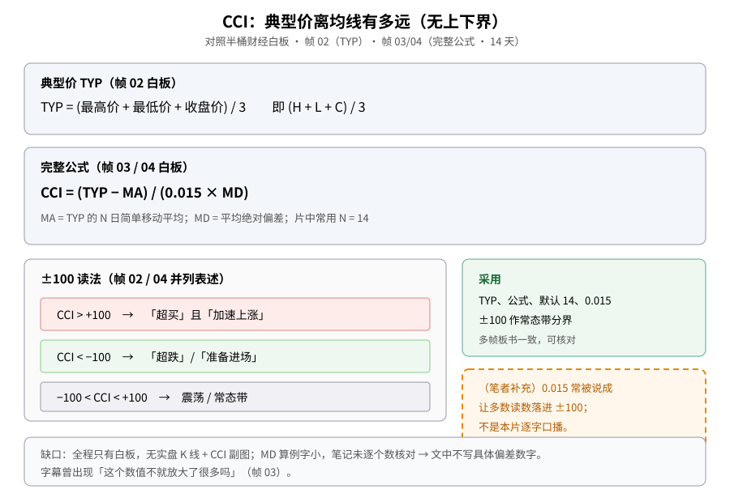
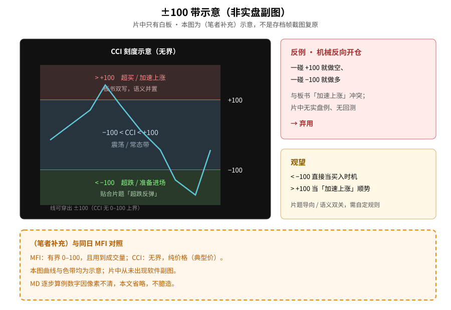
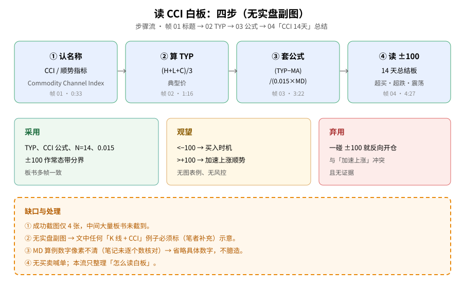

> 学习笔记：半桶财经《超跌反弹的必看指标CCI》（B 站，4:55）。正文只写片中白板和字幕里出现的内容；凡标「（笔者补充）」「（推算）」「示意」的都不是片中原话。**重要缺口**：全程只有手写白板，**没有**实盘 K 线 + CCI 副图；成功截图仅 **4** 张，中间大量板书未截到；MD 算例字小，笔记未逐个数核对——文中**不写**具体偏差数字。**仅供学习，不构成投资建议。**

## 一、它量的是「典型价离均线有多远」

第一次接触 CCI（Commodity Channel Index，商品通道指数 / 顺势指标），先和有界振荡器分开：它问的是**典型价**相对一段均线偏了多少，读数**没有**像 RSI/MFI 那样的 0–100 上下界。

帧 01（约 0:33）白板标题：「CCI, Commodity Channel Index 顺势指标」。帧 02（约 1:16）写出典型价：

> TYP = (最高价 + 最低价 + 收盘价) / 3

即 **TYP = (H + L + C) / 3**。

可对照同日笔记：[MFI 资金流量指数](./2026-11-06-mfi-money-flow-index.md)；以及 [Stochastic](./2026-10-29-stochastic-oscillator.md)、[Williams %R](./2026-11-05-williams-r-keltner-pullback.md)、[Aroon](./2026-11-05-aroon-indicator.md)。

**读图**
- 上两灰框照抄帧 02/03/04 白板：TYP 定义与 CCI = (TYP − MA) / (0.015 × MD)，N 常用 14。
- 左下三色条对照板书并列表述：>+100、&lt;−100、中间震荡。
- 右绿框 = 采用项；右橙虚线框 = （笔者补充）关于 0.015 的通用教材说法，非本片逐字口播。
- 底栏标明：无实盘副图；MD 数字省略。

## 二、完整公式与默认 14

帧 03（约 3:22）与帧 04（约 4:27）白板写出完整式：

> CCI = (TYP − MA) / (0.015 × MD)

其中 MA 是 TYP 的 N 日简单移动平均，MD 是平均绝对偏差；总结板写 **CCI 14天** / N=14。字幕在公式段出现过「这个数值不就放大了很多吗」（帧 03）。

板下方有一组 1…5 的偏差算例，但字小、截图像素下**未逐个数核对**（且不同帧描述一度不一致）→ **本文省略具体数字**，只保留公式结构，避免臆造。

## 三、±100：常态带，不是机械扳机

帧 02 / 03 / 04 反复把阈值写成：

| 条件（板书） | 板书用语 |
|---|---|
| CCI &gt; +100 | 「超买」且「加速上涨」 |
| CCI &lt; −100 | 「超跌」/「准备进场」 |
| −100 &lt; CCI &lt; +100 | 震荡 / 常态区间 |

注意：&gt;+100 同时写了「超买」和「加速上涨」——作者并不把 +100 单纯当成做空信号。片题偏「超跌反弹」，但板书两边都写了极端读法。

**读图**
- 整图外框语境：片中无软件副图，本图是（笔者补充）示意。
- 左黑底刻度示意无界振荡器与 ±100 三带；曲线手绘。
- 右红框：一碰就反向开仓 → **弃用**；右黄框：&lt;−100 买入、&gt;+100 加速上涨 → **观望**。
- 底栏橙虚线框：（笔者补充）与同日 MFI 对照；MD 数字省略。

## 四、怎么读这块白板（四步）

因为没有实盘副图，学习路径就是「读板」：

1. 认名称（帧 01）  
2. 算 TYP（帧 02）  
3. 套公式与 0.015、MD（帧 03）  
4. 用 ±100 分三档读（帧 04 总结）

**读图**
- 上行四蓝框对应四张成功截图的时间点。
- 下行三色框 = 采用 / 观望 / 弃用，与文末表一致。
- 底栏橙框列出截图稀、无副图、MD 数字省略等缺口处理。

## 五、（笔者补充）0.015、与 MFI 对照

- （笔者补充）0.015 是 Lambert 常用常数，教材常说目的是让大约七成左右读数落在 ±100 内——**不是**本片逐字口播。
- （笔者补充）标题和 &lt;−100「准备进场」偏超卖抄反弹；但 &gt;+100 又写「加速上涨」，更像「偏离常态后的两种极端」，而不是单一反向信号。
- （推算）没有趋势过滤、没有止损时，裸用 ±100 逆势，在单边市会反复挨打——需自己回测；片中无证据。
- （笔者补充）与同日 [MFI](./2026-11-06-mfi-money-flow-index.md) 不同：MFI 有界（0–100）且带成交量；CCI 无界、纯价格（典型价）。

## 六、采用 / 观望 / 弃用

| 内容 | 结论 | 理由 |
|---|---|---|
| TYP、CCI 公式、默认 14、0.015 | **采用** | 多帧板书一致，可核对 |
| ±100 作「常态带」分界 | **采用** | 板书反复出现，作读图背景 |
| CCI &lt; −100 直接当买入时机 | **观望** | 片题导向，无回测、无风控、无图表例 |
| CCI &gt; +100 当「加速上涨」顺势信号 | **观望** | 板书并写「超买」与「加速上涨」，语义双关，需自己定规则 |
| 一碰 ±100 就反向开仓 | **弃用** | 与板书「加速上涨」冲突，且无证据 |

## 参考来源

- 半桶财经：[超跌反弹的必看指标CCI](https://www.bilibili.com/video/BV11y4y1j7eA)，时长 **4:55**，已看完 04:55/04:55。
- 文中时间戳来自截图文件名（`screenshots/02-cci/`，成功 **4** 张）。重点：0:33 标题板、1:16 TYP 与 ±100、3:22 完整公式与字幕「这个数值不就放大了很多吗」、4:27「CCI 14天」总结。
- **缺口**：① 仅 4 张关键帧，覆盖偏稀。② 无实盘 K 线 + CCI 副图，只有白板。③ MD 逐步算例字小，未逐个数核对 → 文中省略具体数字。④ 「超买 vs 加速上涨」口播细节只靠板书并列表述。⑤ 前置失败片源（YouTube / 其他 B 站）未当作成片依据。
- 可链接旧文：[MFI（同日）](./2026-11-06-mfi-money-flow-index.md)、[Stochastic](./2026-10-29-stochastic-oscillator.md)、[Williams %R](./2026-11-05-williams-r-keltner-pullback.md)、[Aroon](./2026-11-05-aroon-indicator.md)。

> 学习笔记，仅供学习，不构成投资建议。
