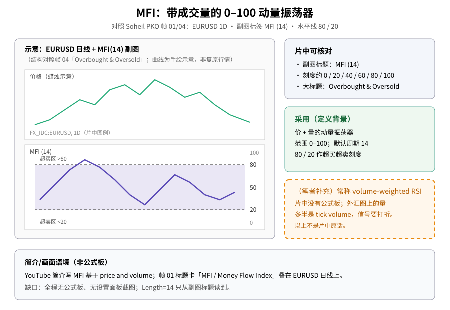
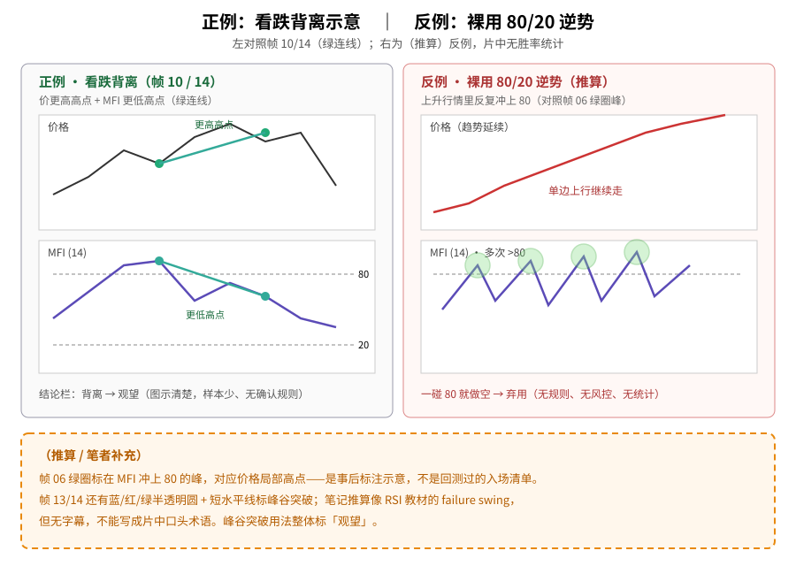
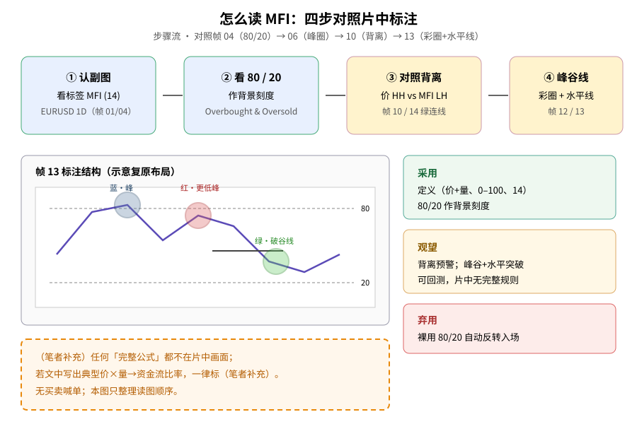

> 学习笔记：Soheil PKO《MFI Indicator Trading Strategy, Explained For Beginners》（YouTube，约 7:50）。正文只写片中画面能核对的内容；凡标「（笔者补充）」「（推算）」的都不是片中原话。**重要缺口**：全程**没有**公式板、**没有**设置面板截图；Length=14 只从副图标题「MFI (14)」读到；无字幕轨可核对，策略细则靠圈选/趋势线推断。**仅供学习，不构成投资建议。**

## 一、先认识它：0–100，价和量一起看

第一次接触 MFI（Money Flow Index，资金流量指数），可以先把它想成「带成交量信息的动量温度计」：读数落在 **0 到 100** 之间。片中演示品种是 **EUR/USD 日线**（图例 `FX_IDC:EURUSD, 1D`），副图标签固定为 **MFI (14)**。

帧 01（约 0:30）标题卡大字「MFI / Money Flow Index」，下方已是 MFI 副图，可见约 80 / 60 / 40 / 20 水平线。帧 04（约 1:45）主标题 **Overbought & Oversold**，上虚线约 **80**、下虚线约 **20**，中间浅色带。YouTube 简介写它是基于 **price and volume** 的动量振荡器——画面本身没有展开公式。

可对照旧文：[RSI 经典 vs 隐藏背离](./2026-10-20-rsi-classical-vs-hidden.md)、[RSI 四种背离](./2026-10-20-rsi-four-divergences.md)、[布林收口 + OBV](./2026-10-21-bollinger-squeeze-bbw-obv.md)。

**读图**
- 左栏对照帧 04：上价格、下 MFI(14)，虚线 80/20，中间浅色带；曲线为手绘示意，不复原具体行情。
- 右上灰框 = 片中可核对标签与刻度；右中绿框 = 本文「采用」项。
- 右下橙虚线框是（笔者补充）：常称 volume-weighted RSI；外汇 tick 量要打折——**不是**片中原话。片中无公式板。

## 二、80 / 20：当背景刻度，不是自动扳机

帧 02–04 反复把 **80 / 20** 画成超买超卖参考。帧 05–06（约 2:20–2:24）在上升行情里，用**半透明绿圈**标出多个 MFI 冲上 80 附近的峰，并大致对齐价格局部高点。帧 07–08（约 3:06–3:43）则在低谷/逼近 20 一带圈出谷。

人话：**看见触及 80 或 20，只说明读数进了极端区**；片中是圈选示意，**没有**写成「一碰就反向开仓」的规则表，也没有止损止盈清单。

## 三、看跌背离：价更高高点，MFI 更低高点

帧 10–11（约 4:47–4:51）和帧 14（约 6:42）给出清楚的**看跌背离**示意：价格两峰用绿线连成上行（更高高点），MFI 两峰连成下行（更低高点）。帧 14 在第二峰之后可见一段明显下跌蜡烛。帧 08–09 一带还有疑似「价更低低点、MFI 更高低点」的淡绿连线，证据偏弱，本文不单独展开。

**读图**
- 左栏正例对照帧 10/14：价 HH + MFI LH 的绿连线结构；标「观望」。
- 右栏反例是（推算）：趋势里多次冲上 80（布局对照帧 06 绿圈峰），若裸做空会被打——标「弃用」。
- 底栏橙虚线框：帧 13 彩圈+水平线、failure swing 叫法均为推算/补充，非片中口头确认。

## 四、彩圈 + 水平线：峰谷突破标注

帧 12–13（约 6:00–6:04）在 MFI 上叠加**蓝 / 红 / 绿**半透明圆，并画**短水平线**标在峰谷与随后突破处。直观读法是：极端区出现峰/谷之后，再等 MFI 跌破（或升破）最近摆动水平——当作动能切换的**示意**。片中**没有**把这套写成可回测的完整步骤，也没有进出场价。

**读图**
- 上行四步：认副图 → 看 80/20 → 对照背离 → 看峰谷水平线，对应帧 04→06→10→13。
- 左下复原帧 13 的蓝/红/绿圆 + 短水平线布局（示意，非像素描摹）。
- 右栏三色框对应采用 / 观望 / 弃用；底栏橙框强调公式不在片中。

## 五、（笔者补充）公式缺口与外汇量

- 教材里 MFI 常被写成「典型价 × 成交量 → 正/负资金流，再做成 RSI 式比率」，并常称 **volume-weighted RSI**。片中**从未出示**公式板，细节以词典/平台文档为准，**不能**写成片中原话。
- 片中外汇图用的量，实务上多半是经纪人 **tick volume**，和股票真实成交量不是一回事，信号质量要打折——片中**没提醒**这句。
- （推算）绿圈「跌破前谷 / 突破前峰」很像 RSI 教材里的 failure swing；因无字幕，**不**写成片中口头术语。

## 六、采用 / 观望 / 弃用

| 内容 | 结论 | 理由 |
|---|---|---|
| MFI 定义（价+量动量、0–100、默认 14） | **采用** | 副图标签与多帧刻度一致；「价+量」来自画面语境/简介，公式未出示 |
| 80/20 超买超卖作背景刻度 | **采用** | 多帧水平线与 Overbought & Oversold 标题一致 |
| 把触及 80/20 当自动反转入场 | **弃用** | 只有圈选示意，无规则、无风控、无统计 |
| MFI 背离作反转预警 | **观望** | 图示清楚，可回测，但样本就几段 EURUSD，且无确认规则 |
| 峰谷 + 水平突破的标注用法 | **观望** | 可写成规则后回测；片中无止损止盈、无文字步骤 |

## 参考来源

- Soheil PKO：[MFI Indicator Trading Strategy, Explained For Beginners](https://www.youtube.com/watch?v=ns5Tbe4x_EA)，时长约 **7:50**，已看完 7:49/7:49（播放器到 Replay）。
- 文中时间戳来自截图文件名（`screenshots/01-mfi/`，14 张）。重点帧：0:30 标题、1:32–1:45 Overbought & Oversold、2:20–2:24 绿圈峰、3:06–3:47 谷与淡线、4:47–4:51 看跌背离、6:00–6:04 彩圈+水平线、6:42 背离后再跌。
- **缺口**：① 无公式板、无设置面板；Length=14 仅副图标题。② 无字幕，细则靠标注推断。③ 约 0:00–1:30 多为口播+标题，画面证据薄。④ 中间重复演示段未另存。⑤ 外汇 tick 量问题片中未提。
- 可链接旧文：[RSI](./2026-10-20-rsi-classical-vs-hidden.md) / [四种背离](./2026-10-20-rsi-four-divergences.md)、[OBV·布林收口（10/21）](./2026-10-21-bollinger-squeeze-bbw-obv.md)、[Williams %R（11/05）](./2026-11-05-williams-r-keltner-pullback.md)。

> 学习笔记，仅供学习，不构成投资建议。
