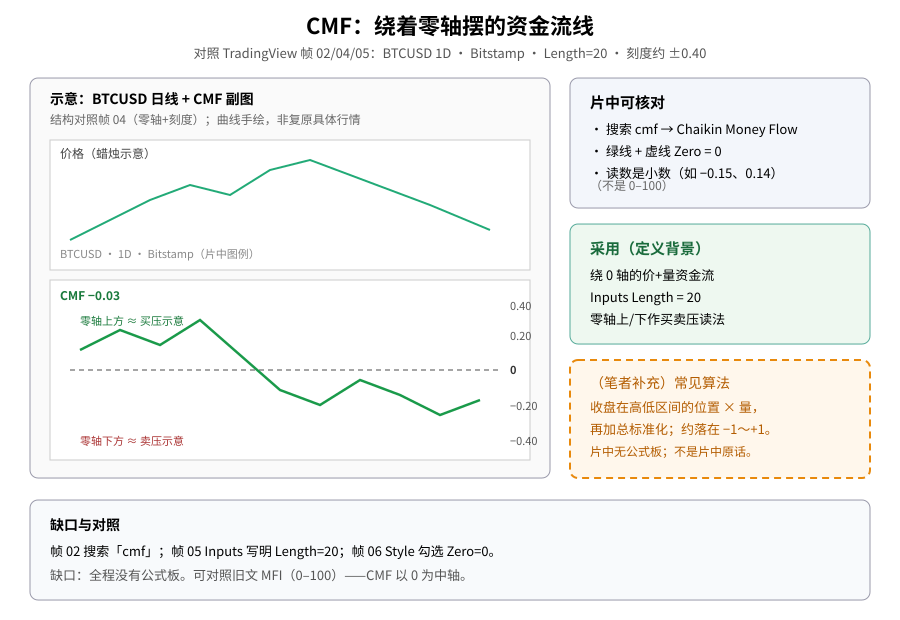
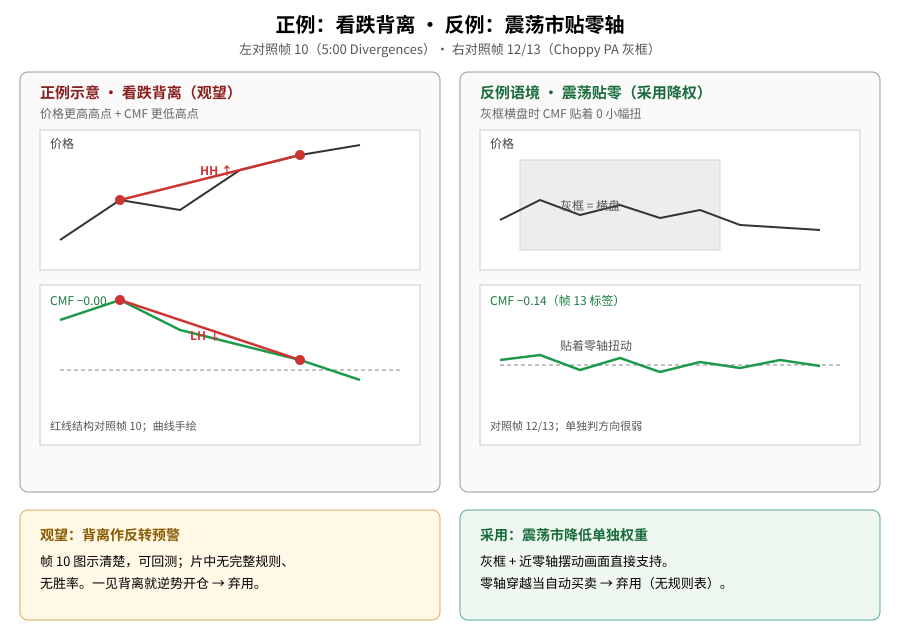
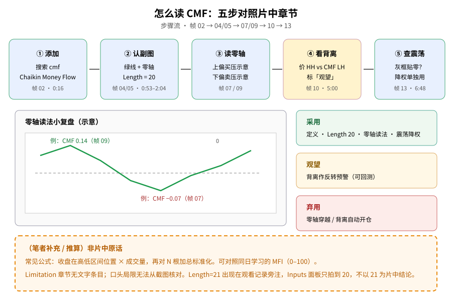

> 学习笔记：TradingView《Chaikin Money Flow: Analyze Buying and Selling Pressure》（YouTube，8:08）。正文只写片中画面能核对的内容；凡标「（笔者补充）」「（推算）」的都不是片中原话。**重要缺口**：全程**没有**公式板；Limitation 章节无文字条目。**仅供学习，不构成投资建议。**

## 一、先认识它：不是 0–100，是绕着 0 摆的小数

第一次接触 CMF（Chaikin Money Flow，蔡金资金流），先把它和 RSI / MFI 分开：它**不是** 0 到 100 的尺子。片中演示品种是 **BTCUSD 日线 · Bitstamp**；副图是一条**绿色**曲线，绕着一条**虚线零轴**上下摆，读数是 **−0.15、0.14** 这类小数，刻度常见 **±0.40 / ±0.20**。

帧 01（0:00）片头只有裸 K 线，还没有 CMF。帧 02（0:16）在 Indicators 搜索框输入 **cmf**，TECHNICALS 高亮 **Chaikin Money Flow**。帧 03–04（0:45–0:53）副图已加上：标签约 **CMF −0.15 → −0.03**，右侧最新值约 **−0.02**，零轴清晰。

可对照旧文：[MFI 资金流量指数（11/06）](./2026-11-06-mfi-money-flow-index.md)、[布林收口 + OBV（10/21）](./2026-10-21-bollinger-squeeze-bbw-obv.md)、[CCI（11/06）](./2026-11-06-cci-commodity-channel-index.md)。

**读图**
- 左栏示意：上价格、下 CMF 绿线 + 虚线零轴，刻度约 ±0.40；曲线手绘，不复原具体行情。
- 右上灰框 = 片中可核对（搜索名、零轴、小数读数）；右中绿框 = 采用项。
- 右下橙虚线框是（笔者补充）常见算法——**不是**片中原话；片中无公式板。

## 二、默认参数：Length = 20

帧 05（2:04）打开 Inputs：**Length = 20**；Timeframe 默认 **Chart**；勾选 **Wait for timeframe closes**。帧 06（2:44）Style：CMF 绿色实线勾选；**Zero = 0** 虚线勾选。

人话：本片/平台演示窗口是 **20 根**。观看记录旁注曾提过别处见过「CMF 21」字样，但现有截图对不上 Inputs 面板的 20 → **不以 21 为片中结论**。

## 三、零轴读法：上方偏买压，下方偏卖压

帧 07（3:28）标签 **CMF −0.07**，右侧约 **−0.10**，线在零轴下方——卖压示意。帧 09（4:09）标签 **CMF 0.14**，CMF 仍在 0 上方，价格高点被红圈标出——买压示意。更早一段高峰大约到 0.25–0.30（画面示意）。

注意：这是**背景读法**，不是「一穿零轴就开仓」的规则表。片中简介提到 zero-line crosses，但画面没有单独的穿越规则表、没有风控、没有统计。

## 四、看跌背离 vs 震荡贴零

帧 10（5:00，章节 Divergences）：价格红线连**更高高点**，CMF 红线连**更低高点**——看跌背离示意；标签 **CMF −0.00**。帧 11（5:52）同一章节后续，标签 **CMF −0.02**。

帧 12–13（约 6:25–6:48，章节 Choppy PA）：灰色方框标出横盘/摩擦区间；6:25 标签约 **CMF 0.01**，6:48 为 **CMF −0.14**，框内 CMF **贴着零轴小幅摆**——单独用来判断方向很弱。

**读图**
- 左栏正例对照帧 10：价 HH + CMF LH 的红连线结构；标「观望」。
- 右栏对照帧 12/13：灰框横盘 + CMF 贴零；标「采用：震荡市降权」。
- 底栏：一见背离/跌破 0 就逆势开仓 → **弃用**。

## 五、怎么读（五步）

1. 搜索添加 Chaikin Money Flow（帧 02）  
2. 认副图：绿线、零轴、Length=20（帧 04/05）  
3. 用零轴读买卖压背景（帧 07/09）  
4. 若出现价 HH vs CMF LH，当作背离示意（帧 10）——观望  
5. 先看是否在灰框式震荡里；若贴零，降低单独权重（帧 13）

**读图**
- 上行五步对应帧 02→04/05→07/09→10→13。
- 中栏复盘零轴上下两个例子（0.14 / −0.07）。
- 右栏三色框 = 采用 / 观望 / 弃用；底栏橙框列补充与缺口。

## 六、（笔者补充）公式缺口与对照 MFI

- （笔者补充）教材常见算法：用收盘价在当天高低区间里的位置当乘数（越靠近最高价越接近 +1），再乘成交量，对最近 N 根加总并除以成交量之和；理论上大约落在 −1 到 +1。片中**从未出示**公式板，**不能**写成片中原话。
- （笔者补充）和 [MFI](./2026-11-06-mfi-money-flow-index.md) 都用到量和价。MFI 更像带量的 RSI（0–100，常用 80/20）；CMF 以 0 为中轴。加密图上的量是交易所成交量，质量参差不齐——片中未展开这句。
- （推算）Limitation 章节（帧 14，7:03）画面仍停在带灰框的图上，口头局限很可能就是「震荡时贴零、信号变差」一类，但没有文字可以核对。

## 七、采用 / 观望 / 弃用

| 内容 | 结论 | 理由 |
|---|---|---|
| CMF 定义（价+量资金流、绕 0 轴、小数读数） | **采用** | 搜索名、副图标签、±0.40 刻度和多帧读数一致；公式未出示 |
| Length = 20 作为 TradingView 默认/本片设置 | **采用** | Inputs 面板写明 20 |
| 零轴上方偏买压、下方偏卖压，当作背景读法 | **采用** | 3:28 与 4:09 的对照画面清楚 |
| 震荡市里 CMF 贴零轴，降低单独使用的权重 | **采用** | 灰框 + 近零轴摆动的画面直接支持 |
| CMF 看跌背离作反转预警 | **观望** | 5:00 图示清楚，可回测，但只是 BTCUSD 日线一段示意 |
| 把零轴穿越当成自动买卖信号 | **弃用** | 简介提到 crosses，但片中没有规则、风控或统计 |
| 一看到背离或跌破 0 就逆势开仓 | **弃用** | 只有标注示意，没有清单和样本外统计 |

## 参考来源

- TradingView：[Chaikin Money Flow: Analyze Buying and Selling Pressure](https://www.youtube.com/watch?v=E_kgb_5Shfc)，时长 **8:08**，已看完 8:08/8:08（播放器到 Replay）。
- 文中时间戳来自截图文件名（`screenshots/01-cmf/`，16 张）。重点帧：0:16 搜索 cmf、0:45–0:53 副图与零轴、2:04 Length=20、2:44 Style Zero=0、3:28 零轴下、4:09 零轴上、5:00 看跌背离、6:25–6:48 震荡灰框、7:03 Limitation、7:45 Summary。
- **缺口**：① 无公式板。② Limitation 无文字条目。③ 片头定义多半靠口播。④ 自动字幕很少叠在图上能读清。⑤ 中后段用了 1.5× 与 360p；关键数字帧已暂停核对。⑥ Length=21 不以片中结论写入。
- 可链接旧文：[MFI（11/06）](./2026-11-06-mfi-money-flow-index.md)、[OBV·布林收口（10/21）](./2026-10-21-bollinger-squeeze-bbw-obv.md)、[CCI（11/06）](./2026-11-06-cci-commodity-channel-index.md)。

> 学习笔记，仅供学习，不构成投资建议。
