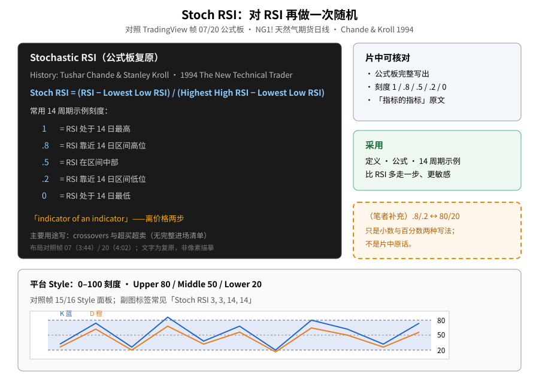
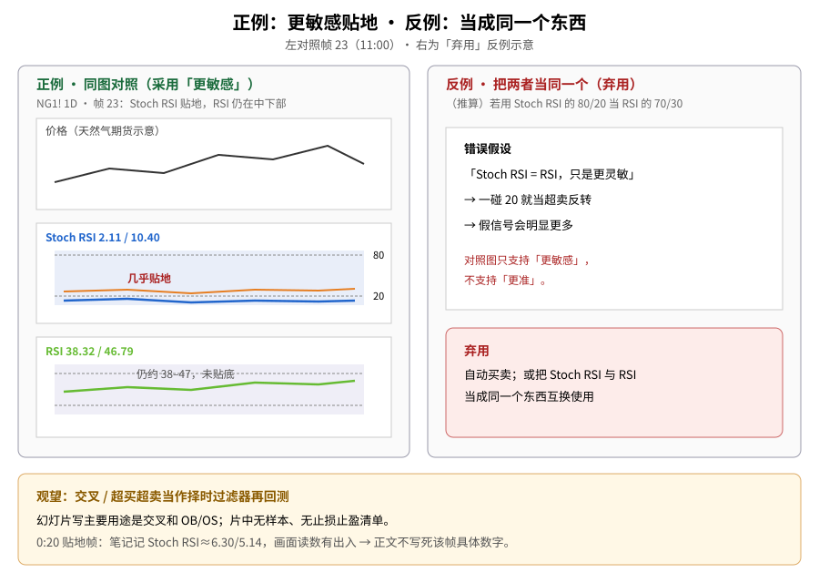
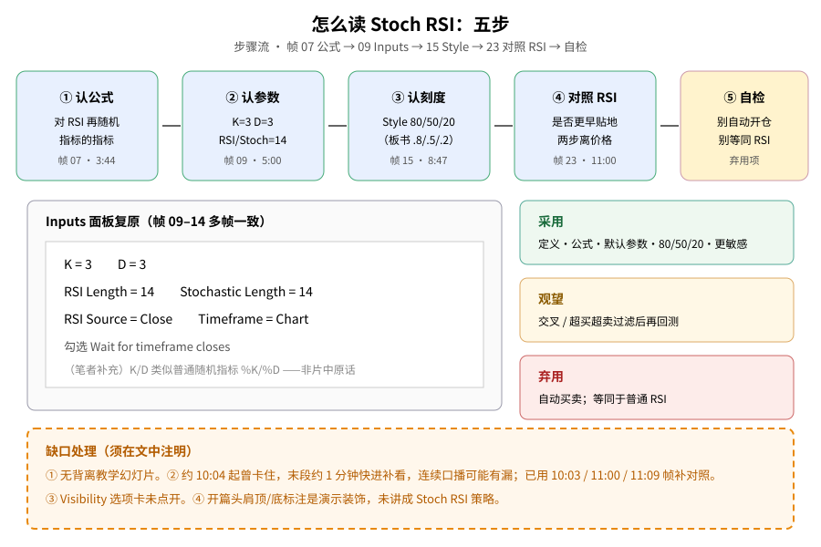

> 学习笔记：TradingView《Stochastic RSI Indicator: Tutorial》（YouTube，播放器显示 11:10）。正文只写片中画面能核对的内容；凡标「（笔者补充）」「（推算）」的都不是片中原话。**重要缺口**：① **没有**背离教学幻灯片；② 约 10:04 起播放曾卡住，**末段约 1 分钟有快进补看**，连续口播可能有漏（已用 10:03 / 11:00 / 11:09 帧补对照）。**仅供学习，不构成投资建议。**

## 一、它不是再画一条 RSI，而是「指标的指标」

第一次接触 Stoch RSI（Stochastic RSI，随机 RSI），先记住片中公式板上的一句：**indicator of an indicator**——它离价格有**两步**：先算 RSI，再对 RSI 的高低位置做类似随机指标的换算。

演示品种是 **NG1! Natural Gas Futures · 1D · NYMEX**。帧 02（0:00）开篇图已叠 Stoch RSI 与 RSI 两个副图，价约 3.467；图上还有 Head and Shoulders / Inverted Head and Shoulders 标注——这是演示装饰，片中**没有**把它讲成 Stoch RSI 策略的一部分。

帧 07 / 20 / 21（约 3:44–4:02）文字幻灯片写出历史与公式：

- 开发者：**Tushar Chande & Stanley Kroll**，1994 年书 *The New Technical Trader*
- 公式：**Stoch RSI = (RSI − Lowest Low RSI) / (Highest High RSI − Lowest Low RSI)**
- 14 日参照刻度：**1 / .8 / .5 / .2 / 0**
- 主要用途写成：crossovers 与超买超卖（**没有**完整进场止损清单，也没有回测数字）

可对照旧文：[RSI 经典 vs 隐藏背离](./2026-10-20-rsi-classical-vs-hidden.md)、[RSI 四种背离](./2026-10-20-rsi-four-divergences.md)、[Stochastic（10/29）](./2026-10-29-stochastic-oscillator.md)、[Williams %R（11/05）](./2026-11-05-williams-r-keltner-pullback.md)、[MFI（11/06）](./2026-11-06-mfi-money-flow-index.md)。

**读图**
- 左黑底复原帧 07/20 公式板：历史、公式、1/.8/.5/.2/0、「指标的指标」。
- 右栏：可核对项与采用项；橙虚线框是（笔者补充）.8/.2 ↔ 80/20。
- 底栏：平台 Style 用 0–100 的 80/50/20，与公式板小数刻度对照。

## 二、默认参数与 80 / 50 / 20

帧 09–14（5:00–8:09）Inputs 多帧一致：

| 参数 | 画面值 |
|---|---|
| K | **3** |
| D | **3** |
| RSI Length | **14** |
| Stochastic Length | **14** |
| RSI Source | Close |
| Timeframe | Chart（勾选 Wait for timeframe closes） |

帧 15–16（8:47–9:25）Style：**K 蓝色、D 橙色**；**Upper Band 80 / Middle Band 50 / Lower Band 20**；Background 打开。副图标签常见 **Stoch RSI 3, 3, 14, 14**（帧 08 一带）。

（笔者补充）公式板上的 **0.8 / 0.2**，对应设置里的 **80 / 20**，只是小数和百分数两种写法——**不是**片中原话。（笔者补充）K、D 的配合很像普通随机指标的 %K / %D，D 通常是 K 的平滑；面板只标了 3 和 3 以及蓝/橙配色，没有另写这句定义。

## 三、比 RSI 更敏感：贴地对照

同一张 NG1! 日线上，Stoch RSI 常常已经掉到 20 以下甚至贴地，普通 RSI 还停在 30–50。

**帧 23（11:00）可核对数字**（笔记与画面一致）：

- Stoch RSI：**2.11 / 10.40**（几乎贴地）
- RSI：**38.32 / 46.79**

帧 17（10:03）：RSI **33.67 / 39.04**；Stoch RSI 靠近 20 一带（笔记约 25.11；该帧 Stoch 读数与部分截图描述有出入，正文**不写死**该具体数字）。帧 22（4:31）：两条线贴近底部，笔记读数约 **0.00 / 15.28**。

帧 03（0:20）：副图两条线贴近底部、带 20–80 阴影；笔记记 Stoch RSI≈6.30/5.14、RSI≈41/53——**画面读数与笔记对 K 值有出入，正文不写死该帧具体 Stoch 数字**，只保留「贴地 vs RSI 仍在中部」这一对照结论。

**读图**
- 左栏正例对照帧 23：Stoch RSI 2.11/10.40 贴地，RSI 仍约 38/47 → 采用「更敏感」。
- 右栏反例是（推算）：把两者当同一个、一碰 20 就反转 → **弃用**。
- 底栏：交叉/OB-OS 过滤标观望；注明 0:20 数字冲突处理。

## 四、怎么读（五步）

1. 认公式与「指标的指标」（帧 07）  
2. 认参数 K=3、D=3、RSI/Stoch Length=14（帧 09）  
3. 认刻度：Style 80/50/20（帧 15）；板书 .8/.5/.2  
4. 同图对照普通 RSI：是否更早到极端（帧 23）  
5. 自检：不要自动开仓，不要把两者当成同一个东西

**读图**
- 上行五步对应帧 07→09→15→23→自检。
- 中栏复原 Inputs 面板；橙虚线补充 K/D 类比。
- 右栏三色框 = 采用 / 观望 / 弃用；底栏列缺口。

## 五、（笔者补充）与缺口

- （推算）Stoch RSI 更容易反复顶到 100、砸到 0；若把它的 80/20 当成普通 RSI 的 70/30 来反向开仓，假信号会更多。对照图支持「更敏感」，**不**支持「更准」。
- **没有**单独的背离（divergence）教学幻灯片或标注。
- Visibility 选项卡只看到标签，没有点开。
- 约 10:04 起播放卡住，后半约 1 分钟有快进补看；中间若还有口播细则，连续画面不完整。10:03、11:00、11:09 三帧对照图仍在。

## 六、采用 / 观望 / 弃用

| 内容 | 结论 | 理由 |
|---|---|---|
| Stoch RSI 定义（对 RSI 再做随机、指标的指标） | **采用** | 3:44 幻灯片写明历史、公式和「indicator of an indicator」 |
| 公式与 14 周期示例 | **采用** | 板书完整，可核对 |
| K=3、D=3、RSI 14、Stochastic 14 作为本片/平台默认 | **采用** | Inputs 多帧一致 |
| 80/50/20（或 .8/.5/.2）当作背景刻度 | **采用** | Style 面板和副图阴影一致 |
| Stoch RSI 比普通 RSI 更敏感、更容易到极端 | **采用** | 11:00 等对照数字清楚；0:20 贴地结构可核对 |
| 交叉 / 超买超卖当作择时过滤器再回测 | **观望** | 概念清楚，可写成规则后验证；本片没有样本 |
| 把 K/D 交叉或触及 80/20 当自动买卖 | **弃用** | 幻灯片只写「主要用途」，没有规则、风控或统计 |
| 用 Stoch RSI 替代 RSI、两者当同一个东西 | **弃用** | 对照图说明两者尺度和行为差很多 |

## 参考来源

- TradingView：[Stochastic RSI Indicator: Tutorial](https://www.youtube.com/watch?v=anoCSnDIwWU)，播放器时长 **11:10**（元数据约 11:11），已看完 11:10/11:10（播放器到 Replay）。
- 文中时间戳来自截图文件名（`screenshots/02-stoch-rsi/`，24 张；NN 序号按截取先后，不完全按时间排序）。重点帧：0:00 NG1! 开篇、0:20 贴地对照、3:44–4:02 公式板、4:22–4:31 副图、5:00–8:09 Inputs、8:47–9:25 Style 80/50/20、10:03 / 11:00 / 11:09 双副图对照。
- **缺口**：① 无完整搜索结果列表（仅 3:46 瞥见输入 stoch）。② Visibility 未点开。③ **无背离幻灯片**。④ **末段约 1 分钟快进补看**（约 10:04 起卡住后 seek）。⑤ 360p+1.5×；0:20 帧 Stoch 具体读数与笔记冲突 → 不写死。⑥ 开篇形态标注未纳入策略。
- 可链接旧文：[RSI](./2026-10-20-rsi-classical-vs-hidden.md) / [四种背离](./2026-10-20-rsi-four-divergences.md)、[Stochastic（10/29）](./2026-10-29-stochastic-oscillator.md)、[Williams %R（11/05）](./2026-11-05-williams-r-keltner-pullback.md)、[MFI（11/06）](./2026-11-06-mfi-money-flow-index.md)。

> 学习笔记，仅供学习，不构成投资建议。
