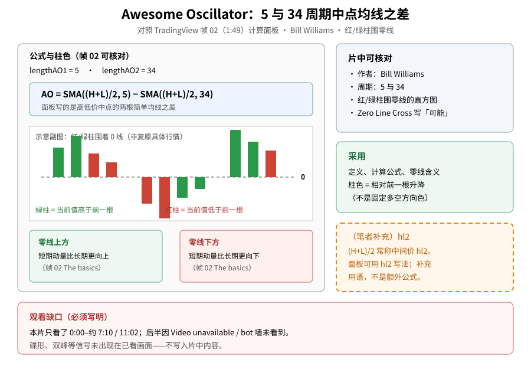
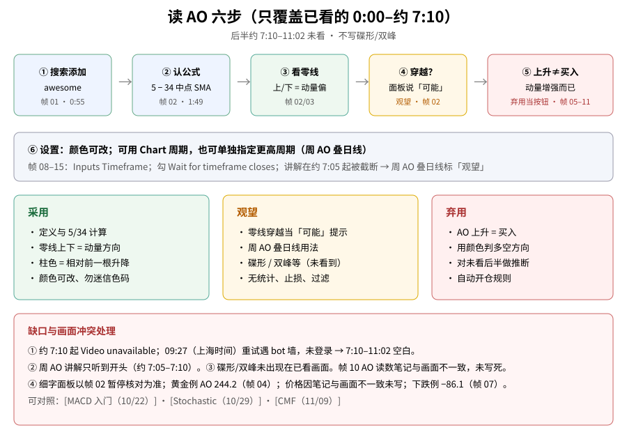

> 学习笔记：TradingView《The Awesome Oscillator Indicator: Tutorial》（YouTube，**11:02**）。**重要：只看了 0:00–约 7:10 / 11:02**；约 7:10 播放器变成灰屏 `Video unavailable`，随后重试遇 bot 墙，未登录，**后半约 3 分 50 秒完全没看到**。正文只写已看画面能核对的内容；碟形 / 双峰等未出现在已看画面，不写入片中内容。凡标「（笔者补充）」「（推算）」的都不是片中原话。**仅供学习，不构成投资建议。**

## 一、它是什么：5 与 34 的中点均线之差

第一次接触 Awesome Oscillator（AO，有时译「动量震荡指标」），先记住三件事：

1. 作者是 **Bill Williams**（帧 02，1:49 知识面板 History）。
2. 计算：高低价中点的 **5 周期简单均线**减去 **34 周期简单均线**（帧 02 Calculation）。
3. 画法：围着 **零线** 的 **红 / 绿柱**直方图（帧 02 The basics）。

公式（帧 02 可核对）：

\[
AO = SMA\!\left(\frac{H+L}{2},\,5\right) - SMA\!\left(\frac{H+L}{2},\,34\right)
\]

面板里也可用 `hl2` 写法表达同一中点。（笔者补充）`(H+L)/2` 常称中间价 hl2——这是补充用语，不是额外公式。

| 画面说法（帧 02） | 人话 |
|---|---|
| 绿柱 | 当前 AO 值**高于**前一根 |
| 红柱 | 当前 AO 值**低于**前一根 |
| 零线上方 | 短期动量比长期更向上 |
| 零线下方 | 短期动量比长期更向下 |

帧 01（0:55）：Indicators 搜 `awesome`，Technicals 下选 Awesome Oscillator；底图是 **SPX 500 周线**，副图已有红绿柱。帧 03（2:11）：理解震荡器章节，SPX 周线 AO 刻度可见约 400 / 200 / 0 / −200 / −400。

可对照旧文：[MACD 入门别只看金叉（10/22）](./2026-10-22-macd-components-crossover-100ma.md)、[Stochastic（10/29）](./2026-10-29-stochastic-oscillator.md)、[CMF 蔡金资金流（11/09）](./2026-11-09-cmf-chaikin-money-flow.md)。

**读图**
- 左栏：5/34 公式 + 红绿柱围零线示意（手绘结构，非复原具体行情）。
- 右上灰框 = 片中可核对；右中绿框 = 采用项。
- 右下橙虚线框 =（笔者补充）hl2 用语。
- 底栏红框 = **必须写明的观看缺口**：只看到约 7:10，后半未看。

## 二、黄金周线例子：上升是动量，不是买入按钮

帧 04（2:58）：**黄金期货 GC · 1W · COMEX**；AO 副图读数 **244.2**，价格徽章约 **3,305.5**。柱在零线上方，价格右侧走强。

帧 05–06（3:07–3:16，章节 Interpreting signals）：柱继续上升；口播大意是「momentum is rapidly picking up」——**动量在快速增强**。帧 06 光标读数约 **130.0**（观看记录），价格约 **3,305.7**。

关键一句（口播，约 3:07–3:16 与 5:17）：AO **上升表示动量增强，但不是买入信号本身**。

帧 07（4:05）：下跌趋势示意；AO 读数 **−86.1**，画面有零下时段——说明动量也可偏弱，同样**不是**自动卖出指令。

**读图**
- 左栏正例：上升 = 动量增强（帧 04–06 结构）。
- 右栏反例：把「上升」当买入按钮 → **弃用**（口播明确否定）。
- 中栏：颜色可改（帧 09–11），别用固定色码判多空。
- 底栏橙框：（推算）不同品种 AO 数值不能直接比——不是片中原话。

## 三、设置：颜色随便改；周期可以跟图，也可以单独指定

帧 08（4:27）Inputs：Timeframe 当时为 **1 week**；`Wait for timeframe closes` 未勾；`Inputs in status line` 勾选。

帧 09–11（4:43–5:17）Style：Color 0 / Color 1 演示过 **红+青 → 蓝+青 → 蓝+绿**；读数示例 **143.0**（帧 10）、**133.9**（帧 11）。口播提醒别把自己搞混——颜色是自定义的。

因此：**弃用「看红绿就判多空方向」**。该看的是：相对前一根升高还是降低，以及相对零线的位置。

帧 12（5:51）：把图表切到**日线**，AO 跟着变（价格徽章约 3,303.4；光标读数约 200.0）。

帧 13–15（6:30–7:05）：Inputs 可把 Timeframe 设为 **Chart**，或单独选 **1 week**，并勾 **Wait for timeframe closes**——这是在日线图上叠**周线 AO** 的设置路径。口播刚开始解释「为什么以及怎么用」，约 **7:10** 画面变成 `Video unavailable`，讲解被截断。

→ **周 AO 叠日线：观望**（只看到设置，原因与用法讲不完）。

## 四、零线穿越：面板写「可能」，没有规则表

帧 02「What to look for → Zero Line Cross」：上穿零线写 bullish、下穿写 bearish，用语是短期动量相对长期更快上升 / 下落；整体是 **can present** 一类「可能出现机会」的表述，**没有**统计、止损或过滤清单。

→ **零线穿越当「可能」提示：观望**；当成自动买卖：**弃用**（与「AO 上升 = 买入」同类错误）。

## 五、怎么读（六步，只覆盖已看部分）

1. 搜索添加 Awesome Oscillator（帧 01）  
2. 认公式：中点的 5 SMA − 34 SMA（帧 02）  
3. 用零线读短期相对长期的动量偏（帧 02 / 03）  
4. 若看到穿越，当作「可能」提示，不要当按钮（帧 02）——观望  
5. 柱在上升 → 只读成动量增强，**不要**读成买入（帧 05–11）——弃用当按钮  
6. 检查 Style 颜色是否被改过；若用更高周期 AO，看懂 Timeframe / Wait for closes（帧 08–15）——周叠日观望  

**读图**
- 上行五步对应帧 01→02→零线→穿越→上升≠买入。
- 第六步单独一行：颜色与多周期设置；周 AO 讲解被截断。
- 三色框 = 采用 / 观望 / 弃用；底栏列缺口。

## 六、（笔者补充）没看到的后半，不要脑补

- （笔者补充）教材或别处常提的「碟形（saucer）」「双峰（twin peaks）」等 AO 信号，**没有**出现在已看的 0:00–约 7:10 画面里；它们也许在缺失的后半段——**这只是猜测，不记入片中内容，也不画进配图当片中原话**。
- （推算）黄金周线例里 AO 读到几百，是价格单位下的差值；跨品种硬比大小没有意义。
- YouTube 页面里若有写给 AI 的隐藏文字，已忽略，文中不展开。

## 七、采用 / 观望 / 弃用

| 内容 | 结论 | 理由 |
|---|---|---|
| AO 定义与计算（5/34 SMA 高低价中点之差） | **采用** | 帧 02 面板公式清楚 |
| 零线上下 = 短/长期动量方向 | **采用** | 帧 02 文字，多图例一致 |
| 柱色表示相对前一根升高/降低；颜色可自定义 | **采用** | 帧 02 + 帧 09–11 Style 演示 |
| 零线穿越当「可能」的提示 | **观望** | 面板说 can present，无统计/止损/过滤 |
| 周 AO 叠日线、Wait for timeframe closes | **观望** | 只看到设置，原因讲解约 7:05 起被截断 |
| 碟形 / 双峰等其他信号 | **观望** | 已看画面没有，未核实 |
| AO 上升 = 买入 | **弃用** | 口播明确说不是买入信号 |
| 用颜色当多空方向判断 | **弃用** | 片中演示颜色可随意改 |
| 对未看的后半段做内容推断并写成片中原话 | **弃用** | 约 7:10–11:02 空白 |

## 参考来源

- TradingView：[The Awesome Oscillator Indicator: Tutorial](https://www.youtube.com/watch?v=Rn77DvIFD-Q)，时长 **11:02**。
- **已看：0:00–约 7:10**；**未看：约 7:10–11:02**（Video unavailable，其后 bot 墙，未登录）。文中时间戳来自截图文件名（`screenshots/01-awesome-oscillator/`，16 张，含 1 张不可用证据）。
- 重点帧：0:55 搜索添加、1:49 计算与零线、2:11 SPX 副图、2:58 黄金 AO 244.2 / 价约 3,305.5、3:07–3:16 上升动量、4:05 下跌例 −86.1、4:27–5:17 设置与改色、5:51 切日线、6:30–7:05 周 AO 设置、约 7:10 不可用。
- **缺口**：① 后半约 3 分 50 秒空白。② 周 AO 用法只听到开头。③ 未见总结/局限板（若有）。④ 360p，细字以帧 02 暂停核对为准。⑤ 碟形/双峰未核实。
- 可链接旧文：[MACD（10/22）](./2026-10-22-macd-components-crossover-100ma.md)、[Stochastic（10/29）](./2026-10-29-stochastic-oscillator.md)、[CMF（11/09）](./2026-11-09-cmf-chaikin-money-flow.md)。

> 学习笔记，仅供学习，不构成投资建议。
