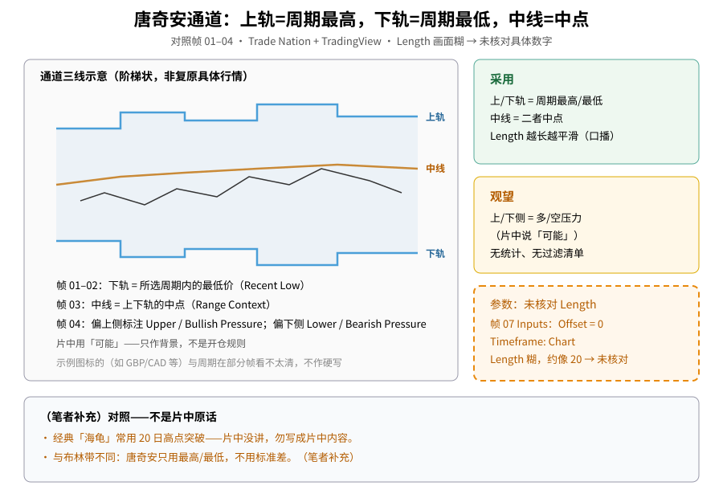
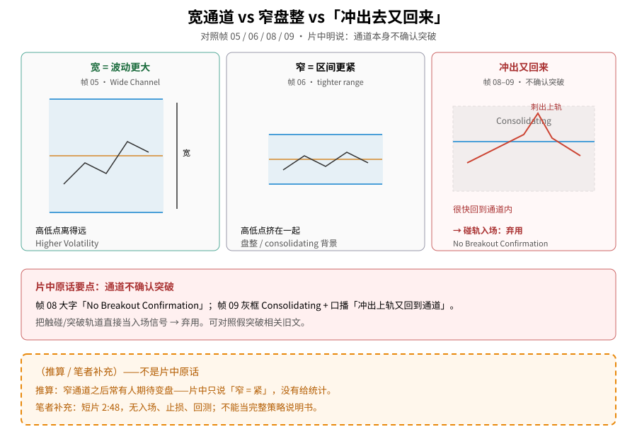
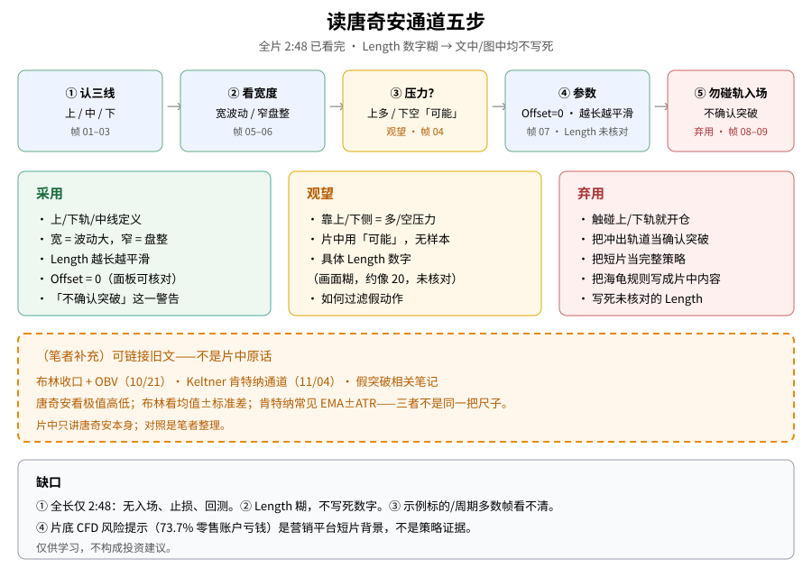

> 学习笔记：Trade Nation + TradingView《Donchian Channels on TradingView》（YouTube，**2:48**，已看完 2:48/2:48）。正文只写片中画面能核对的内容；凡标「（笔者补充）」「（推算）」的都不是片中原话。**Length 数字在 Inputs 面板上过糊，文中与配图均不写死具体值**（约像 20，标「未核对」）。短片无入场 / 止损 / 回测。**仅供学习，不构成投资建议。**

## 一、三根线：最高、最低、中点

第一次接触唐奇安通道（Donchian Channels），先别把它想成「碰轨就开仓」的信号灯。片中演示的是价格外面套着三根线：

| 线 | 片中定义（帧 01–03） |
|---|---|
| **上轨（Upper Band）** | 所选周期内的**最高价** |
| **下轨（Lower Band）** | 所选周期内的**最低价**（标注 Recent Low） |
| **中线（Middle Line）** | 上下轨的**中点**（标注 Range Context） |

帧 01–02（0:41–0:45）：箭头指向下轨，口播 / 字幕说明下轨标记同一周期里的最低价。帧 03（0:53）：中线给高低两端之间一个「区间上下文」。

通道画出来常常是**阶梯状**：一段时间内没有新高 / 新低，轨就横着；一旦创出新极值，对应的轨才上下挪。

可对照旧文：[布林带收口 + OBV（10/21）](./2026-10-21-bollinger-squeeze-bbw-obv.md)、[Keltner 肯特纳通道（11/04）](./2026-11-04-keltner-channel.md)、[假突破相关：失败突破教训（10/20）](./2026-10-20-failed-breakout-upper-wick-lower-high-lesson.md)。

**读图**
- 左栏：上轨 / 中线 / 下轨阶梯示意（手绘，非复原具体行情）。
- 右栏绿 = 采用；黄 = 观望（多空压力）。
- 右下橙虚线框：Offset = 0 可核对；**Length 糊 → 未核对**，不写死数字。
- 底栏：（笔者补充）海龟 / 与布林差异——不是片中原话。

## 二、靠上侧 / 靠下侧：「可能」的压力背景

帧 04（1:13）：上半通道标 **Upper Channel ↑ Bullish Pressure**，下半标 **Lower Channel ↓ Bearish Pressure**。口播 / 字幕用的是「pressure may be more active」一类——价格偏在上侧或下侧，**可能**对应多 / 空压力更活跃。

这是**背景读法**，不是「一进上半通道就做多」的规则表。片中没有统计样本。

→ **多 / 空压力：观望**。

## 三、宽度：宽 = 波动大，窄 = 更紧的盘整

帧 05（1:23）：标注 **Wide Channel → Higher Volatility**；字幕说近期高低点离得远，通道就更宽。

帧 06（1:32）：更窄的通道对应 **tighter range**——价格挤在更紧的区间里。帧 09 还会用灰框标 **Consolidating**。

→ **宽度反映波动 / 盘整：采用**（多张标注一致）。

（推算）有人会说「收窄之后常跟着变盘」——片中**只**说了窄 = 紧，**没有**给统计；推算不能写成片中结论。

## 四、参数：Length 越长越平滑；数字本身未核对

帧 07（1:53）打开 DC Inputs：

- **Offset = 0**（可核对）
- **Timeframe: Chart**
- **Wait for timeframe closes**（观看记录：已勾选）
- **Length**：画面过糊，**看起来约像 20，但未能核实** → 文中与配图一律标 **未核对**，**不写死「Length = 20」**

口播：Length 越长，通道越平滑，更偏看长期运动。

→ **「越长越平滑」这一性质：采用**；**具体 Length 数字：不采用为事实**。

## 五、最重要的一句：通道不确认突破

帧 08（2:07）：图上大字 **No Breakout Confirmation**；字幕：「One limitation is that Donchian channels do not confirm breakout」。

帧 09（2:15）：灰框标 **Consolidating**；口播描述价格冲出上轨后**很快回到通道内**——盘整里的假动作示意。

因此：

- **把触碰 / 突破上轨或下轨直接当入场 → 弃用**
- **把「冲出轨道」当成突破已经确认 → 弃用**

**读图**
- 左：宽通道 = 更高波动（帧 05）。
- 中：窄通道 = 更紧区间（帧 06）。
- 右：Consolidating 里刺出又回来（帧 08–09）→ 碰轨入场弃用。
- 底栏橙框：（推算 / 笔者补充）窄后变盘、短片无策略细节——不是片中原话。

## 六、怎么读（五步）

1. 认出上轨 / 中线 / 下轨分别是周期最高、中点、最低（帧 01–03）  
2. 先看宽度：宽偏波动大，窄偏盘整（帧 05–06）  
3. 若价格长期贴上侧或下侧，只当「可能」的压力背景（帧 04）——观望  
4. 看 Inputs：Offset 0；Length **未核对**；记住越长越平滑（帧 07）  
5. 永远记住：通道**不确认**突破；冲出去又回来很常见（帧 08–09）——勿碰轨开仓  

**读图**
- 上行五步对应帧 01–03 → 05–06 → 04 → 07 → 08–09。
- 三色框 = 采用 / 观望 / 弃用。
- 橙框：与布林、肯特纳的对照是（笔者补充）。
- 底栏列缺口与 CFD 风险条背景。

## 七、（笔者补充）别把别处的规则写进这篇

- （笔者补充）经典「海龟」交易系统常用 **20 日**高点突破一类规则——**本片没有讲**，不要写成片中内容；也正因为 Length 未核对，更不能反推「片中就是海龟 20」。
- （笔者补充）布林带常用均值 ± 标准差；肯特纳常见 EMA ± ATR；唐奇安只用周期内最高 / 最低。三把尺子不同——对照见旧文，非片中原话。
- 片底滚动条有 CFD 风险提示（画面可见约 **73.7%** 零售账户亏钱）——这是营销平台短片的合规提示，**不是**策略回测证据。

## 八、采用 / 观望 / 弃用

| 内容 | 结论 | 理由 |
|---|---|---|
| 上 / 下轨 / 中线定义（最高 / 最低 / 中点） | **采用** | 帧 01–03 标注与口播一致 |
| 通道宽度反映波动、盘整 vs 扩张 | **采用** | 帧 05–06、09 多张标注一致 |
| Length 越长越平滑、偏长期 | **采用** | 口播 + 设置上下文 |
| Offset = 0 | **采用** | 帧 07 面板可核对 |
| 「通道不确认突破」这一警告 | **采用** | 帧 08–09 大字 + 冲出又回示意 |
| 价格靠上 / 下侧 = 多 / 空压力 | **观望** | 片中用「可能」，无统计 |
| 具体 Length 数值（约像 20） | **未核对 / 不写入事实** | 画面过糊 |
| 触碰或突破轨道直接当入场 | **弃用** | 片中明说不确认突破 |
| 把海龟 20 日规则写成片中内容 | **弃用** | 片中未讲；Length 亦未核实 |

## 参考来源

- Trade Nation + TradingView：[Donchian Channels on TradingView](https://www.youtube.com/watch?v=AnjZnA7Cztc)，时长 **2:48**，已看完 **2:48/2:48**。
- 文中时间戳来自截图文件名（`screenshots/02-donchian-fallback/`，9 张）。重点帧：0:41–0:45 下轨、0:53 中线、1:13 多空压力标注、1:23 宽通道、1:32 窄区间、1:53 Inputs（Offset 0；Length 糊）、2:07 No Breakout Confirmation、2:15 Consolidating。
- **缺口**：① 仅 2:48，无入场 / 止损 / 回测。② **Length 未核对**。③ 示例标的与周期多数帧看不清。④ 无过滤假突破的细则。⑤ 片底为 CFD 营销风险条。
- 可链接旧文：[布林收口 + OBV（10/21）](./2026-10-21-bollinger-squeeze-bbw-obv.md)、[Keltner（11/04）](./2026-11-04-keltner-channel.md)、[失败突破教训（10/20）](./2026-10-20-failed-breakout-upper-wick-lower-high-lesson.md)。

> 学习笔记，仅供学习，不构成投资建议。
