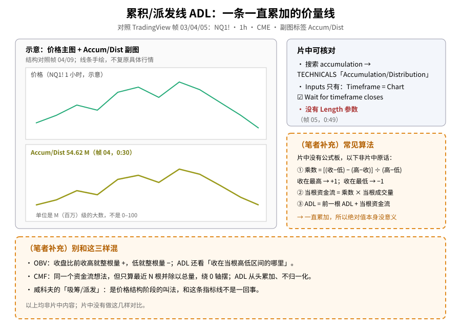
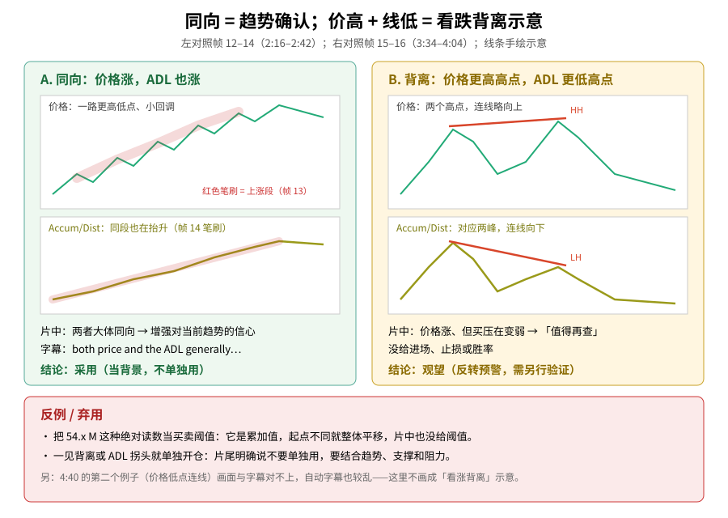
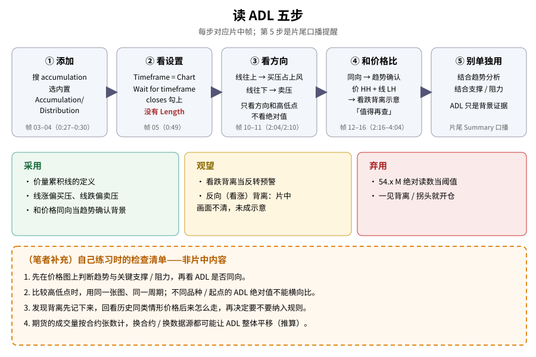

> 学习笔记：TradingView《Accumulation Distribution for Trend Confirmation》（YouTube，列表时长 5:25，播放器显示 5:24）。正文只写片中画面能核对的内容；凡标「（笔者补充）」「（推算）」的都不是片中原话，图里一律画成**橙色虚线框**。**重要缺口**：片中**没有**公式板，也没有讲它和 OBV / CMF 的区别。**仅供学习，不构成投资建议。**

## 一、先认识它：一条一直往上加、往下减的价量线

ADL（Accumulation/Distribution Line，累积/派发线）是一条把「价格」和「成交量」揉在一起、**从头一路累加**的线。片中演示品种是 **NQ1!（纳指 100 E-mini 期货）1 小时 · CME**。

帧 03（0:27）在 Indicators 搜索框输入 **accumulation**，选内置的 **Accumulation/Distribution**。帧 04（0:30）提示「Indicator added」，副图出现一条线，左上标签 **Accum/Dist 54.62 M**。

第一次看要先记住两件事：

- 它的读数是 **54.x M**（百万级）这种大数，**不是** RSI / MFI 那样的 0–100；
- 正因为是累加出来的，**绝对值本身没意义**，要看的是**方向**和**高低点**。

片中（1:50 章节 Price and Volume）口播的定位是：它在衡量资金是**流入还是流出**一个资产（flowing into or out of an asset）。

**读图**
- 左栏示意：上价格、下 Accum/Dist 副图，标签按帧 04 写 **54.62 M**；线条是手绘示意，不复原行情。
- 右上灰框是片中能核对的：搜索名、Inputs 只有两项、**没有 Length**。
- 右中、下方两个**橙色虚线框**都是（笔者补充）：常见算法，以及和 OBV / CMF / 威科夫「吸筹派发」的区别——**都不是片中原话**。

## 二、设置：没有 Length，只有两项

帧 05（0:49）打开 Inputs，只有：

- **Timeframe = Chart**
- **Wait for timeframe closes**（勾选）

**没有 Length 参数**——这和 [CMF（11/09）](./2026-11-09-cmf-chaikin-money-flow.md) 的 Length 20、[MFI（11/06）](./2026-11-06-mfi-money-flow-index.md) 的窗口长度都不一样，因为 ADL 不是「最近 N 根」，而是从图表数据开头一路累加。

帧 06（1:01）Style、帧 07–08（1:10–1:22）Visibility，口播的意思是一般保持默认即可。Style 里「Inputs in status line」和 Visibility 里 Ranges 的勾选状态，观看笔记与画面不一致（笔记与画面读数不一致，未写具体数值）——这里不写具体勾选。

## 三、方向：往上偏买压，往下偏卖压

帧 10（2:04）标出线往上的一段，字幕 **buying pressure is prevailing**（买压占上风）；帧 11（2:10）标出往下的一段，对应**卖压**。

人话：ADL 往上走，说明「收在当根偏高位置、且有量」的 K 线占多数；往下走则相反（这句解释的后半是（笔者补充），片中只说买压 / 卖压）。

帧 10 的副图标签读数，观看笔记与截图辨认不一致（笔记与画面读数不一致，未写具体数值）。

## 四、趋势确认：两者同向，信心更足

章节 **Trend Confirmation**（2:16–2:42）：

- 帧 12（2:16）：NQ1! 有一段明显上涨。
- 帧 13（2:28）：价格上涨段被**红色笔刷**标出，字幕说一路**更高的低点**、只有**小回调**继续往上推。
- 帧 14（2:42）：同一段 ADL 也被红色笔刷标出、同样在抬升，字幕 **So, both price and the ADL generally…**，标签 **Accum/Dist 54.92 M**。

片中的结论是：**价格和 ADL 大体同向**时，可以增强对当前趋势的信心。

## 五、背离：价格更高高点，ADL 更低高点

章节 **Finding Divergence**：

- 帧 15（3:34）：价格的一个高点、以及 ADL 上对应的**较低**峰被椭圆圈出。
- 帧 16（4:04）：画了两条趋势线——价格连高点**向上**、ADL 连高点**向下**。这是**看跌背离**示意：价格还在创新高，但量价累积线没跟上。片中口播（约 4:16）只说这种情况**值得进一步调查**，**没有**给进场、止损或胜率。

帧 17（播放器时钟 **4:40**，文件名写成 0452）还有第二个例子：在价格低点和 ADL 低点各画了一条线，字幕 **I would lean towards a divergence**。但这一帧画面里 ADL 低点连线接近水平、看不出清楚的方向，而约 4:52 的口播和这一帧对不上——所以**这里不把它写成「看涨背离」**，也不写这一帧的读数（笔记与画面读数不一致，未写具体数值）。

可以对照旧文：[CMF 看跌背离（11/09）](./2026-11-09-cmf-chaikin-money-flow.md)、[布林收口 + OBV（10/21）](./2026-10-21-bollinger-squeeze-bbw-obv.md)。

**读图**
- 左栏对照帧 13–14：价格上涨段和 ADL 上涨段各有一道红色笔刷，两者同向 → **采用**（当背景）。
- 右栏对照帧 15–16：价格高点连线向上（HH）、ADL 高点连线向下（LH）→ **观望**，片中只说「值得再查」。
- 底栏是反例：把 54.x M 当阈值、一见背离就开仓 → **弃用**；并注明 4:40 的例子不画成看涨背离。

## 六、怎么读（五步）

1. 搜 accumulation，添加 Accumulation/Distribution（帧 03–04）
2. 看设置：Timeframe = Chart、Wait for timeframe closes，**没有 Length**（帧 05）
3. 只看方向：往上偏买压、往下偏卖压（帧 10–11）
4. 和价格比：同向 = 趋势确认；价 HH + 线 LH = 看跌背离示意，值得再查（帧 12–16）
5. 片尾 Summary（约 5:04 起）口播：**不要单独用**，要结合趋势分析、支撑和阻力

**读图**
- 上行五步分别对应帧 03–04 → 05 → 10–11 → 12–16 → 片尾口播。
- 中间三色框 = 采用 / 观望 / 弃用。
- 底部橙色虚线框是（笔者补充）的练习清单，不是片中内容；第 4 条标了（推算）。

## 七、（笔者补充）公式和容易混的几个概念

- （笔者补充）常见算法：先算**乘数** = [(收 − 低) − (高 − 收)] ÷ (高 − 低)，收在最高为 +1、收在最低为 −1；乘以当根成交量得到当根「资金流」；ADL = 上一根 ADL + 当根资金流。片中**没有**出示公式，不能写成片中原话。
- （笔者补充）和 [OBV](./2026-10-21-bollinger-squeeze-bbw-obv.md) 的区别：OBV 只看「收盘比前收高还是低」，整根量要么加、要么减；ADL 看「收在当根高低区间的哪里」，按比例加减。所以有时收盘上涨、但收在当根偏下方，ADL 反而会减。
- （笔者补充）和 [CMF](./2026-11-09-cmf-chaikin-money-flow.md) 的区别：CMF 用同一个乘数，但只算最近 N 根、再除以成交量之和，所以绕 0 轴摆；ADL 从头累加，不归一化。
- （笔者补充）这里的 Accumulation / Distribution 是**指标名**，和 [威科夫里的「吸筹 / 派发」阶段（10/05）](./2026-10-05-威科夫入门：三大定律加一张事件顺序图，读懂吸筹与出货.md) 不是一回事——后者讲的是价格结构，不是这条线。

## 八、采用 / 观望 / 弃用

| 内容 | 结论 | 理由 |
|---|---|---|
| ADL 定义：价量累加线，读数是 54.x M 这类大数 | **采用** | 搜索名、副图标签和多帧读数一致；公式未出示 |
| 线往上偏买压、往下偏卖压 | **采用** | 2:04 / 2:10 两段标注清楚 |
| 价格与 ADL 同向当作趋势确认背景 | **采用** | 2:16–2:42 的笔刷画面直接支持 |
| 价 HH + ADL LH 的看跌背离当反转预警 | **观望** | 4:04 示意清楚，但片中只说「值得再查」，只有一段 NQ1! 1h 示例 |
| 看涨背离 | **观望** | 4:40 那一例画面与字幕对不上，不成示意 |
| 把 54.x M 这类绝对读数当买卖阈值 | **弃用** | 累加值、起点不同就整体平移，片中也没给任何阈值 |
| 一见背离就开仓 | **弃用** | 片尾口播明确说不要单独用；没有规则、风控或统计 |

## 参考来源

- TradingView：[Accumulation Distribution for Trend Confirmation](https://www.youtube.com/watch?v=xLqbUsgkDtQ)，列表时长 **5:25**，已看完 **5:24/5:24**（1.25×，360p，未登录）。
- 章节：Add indicator → Settings → Price and Volume → Trend Confirmation → Finding Divergence → Summary。
- 文中时间戳来自截图（`screenshots/01-accumulation-distribution/`，18 张）与观看记录。重点帧：0:27 搜索、0:30 加上（54.62 M）、0:49 Inputs、1:01 Style、1:10–1:22 Visibility、2:04 买压、2:10 卖压、2:16–2:42 趋势确认、3:34 背离区域、4:04 看跌背离趋势线、4:40 第二例、5:24 结尾。
- **缺口**：
  ① 无公式板，公式与 OBV / CMF 对比全部是（笔者补充）。
  ② 帧 17 文件名为 0452，但播放器时钟是 **4:40**；约 4:52 的口播不当作画面证据，该帧读数未写。
  ③ 帧 10、帧 17 的 Accum/Dist 读数，观看笔记与画面不一致，未写具体数值。
  ④ 帧 06（Style）、帧 07（Visibility）的勾选状态，笔记与画面不一致，未写。
  ⑤ 0:08–0:27、1:22–1:50、2:42–3:34、4:04–4:40、5:04–5:24 这几段没有新画面截图，内容只靠口播或字幕。
  ⑥ 自动字幕在 4:04 一段较乱（价格 / ADL 高低说法颠倒），以画面趋势线为准。
  ⑦ 开头曾遇加载错误后从 0:00 重看；中途两次快进过头已倒回补看。
- 可链接旧文：[OBV·布林收口（10/21）](./2026-10-21-bollinger-squeeze-bbw-obv.md)、[CMF（11/09）](./2026-11-09-cmf-chaikin-money-flow.md)、[MFI（11/06）](./2026-11-06-mfi-money-flow-index.md)、[威科夫入门（10/05）](./2026-10-05-威科夫入门：三大定律加一张事件顺序图，读懂吸筹与出货.md)。

> 学习笔记，仅供学习，不构成投资建议。
