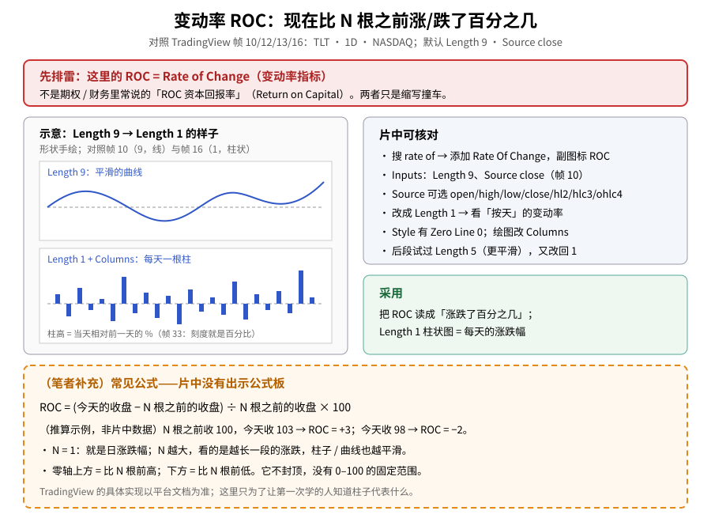
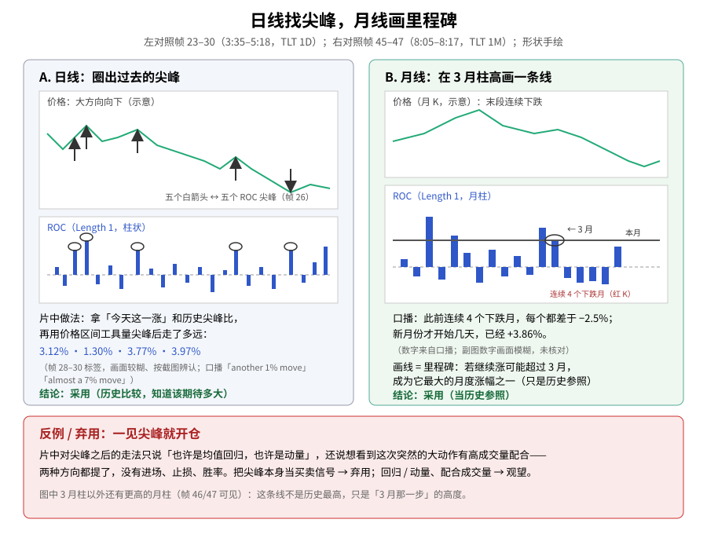
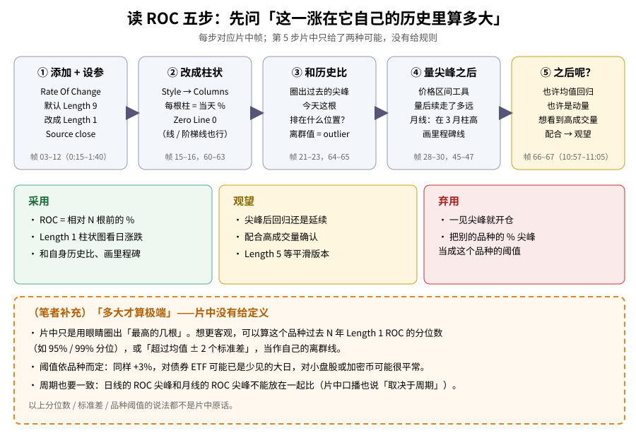

> 学习笔记：TradingView《Spot Big Moves With The Rate of Change Indicator》（YouTube，11:25）。正文只写片中画面能核对的内容；凡标「（笔者补充）」「（推算）」的都不是片中原话，图里一律画成**橙色虚线框**。**重要缺口**：这支片是**分两次看完**的——前半段（0:00–6:30）那次运行中断、**没有留下观看记录**，前半段的口播只能从截图里的字幕复原；后半段截图画质低、下半部被裁掉。片中**没有**公式板。**仅供学习，不构成投资建议。**

## 一、先排雷：这里的 ROC 不是「资本回报率」

先把名字分清楚：本文的 ROC 是 **Rate of Change（变动率）**，一个技术指标。它**不是**期权 / 财务话题里常说的 **「ROC 资本回报率」（Return on Capital）**——两者只是缩写撞车，算的东西完全不同。

## 二、它在量什么：现在比 N 根之前涨跌了百分之几

片中演示品种是 **TLT（iShares 20+ Year Treasury Bond ETF，美国 20 年以上国债 ETF）日线 · NASDAQ**，片头是一段下跌趋势（帧 01–02，0:00–0:03）。

- 帧 03–06（0:15–0:39）：搜索框输入 **rate of**，加入 **Rate Of Change**，副图出现标着 **ROC** 的折线。
- 帧 09（1:11）：字幕的意思是——rate of change 就是字面意思，它在测量……（截图里字幕到此为止，后半句没有记录）。
- 帧 10（1:22）：Inputs 默认 **Length = 9**、**Source = close**，Timeframe = Chart，勾选 Wait for timeframe closes。
- 帧 11–12（1:31–1:40）：口播 Length 就是「你要它算多长」；随后改成 **1**。
- 帧 13（1:49）：Source 下拉可选 open / high / low / close / hl2 / hlc3 / ohlc4，字幕「We could even do OHLC / 4」。
- 帧 14（1:58）：字幕 **rate of change by day**——Length 1 时，看的就是**按天**的变动率。
- 帧 33（6:17）：字幕的意思是副图刻度上能直接看出移动了多少**百分比**。

人话：Length 1 的 ROC 柱，就是**每天相对前一天涨跌了百分之几**。

**读图**
- 顶部红框先排雷：Rate of Change ≠ 资本回报率。
- 左栏示意 Length 9（平滑曲线）和 Length 1 + Columns（每天一根柱）的样子；形状手绘，不复原 TLT 行情。
- 右上灰框是片中能核对的设置；右中绿框是采用项。
- 底部**橙色虚线框**是（笔者补充）的公式和推算示例（100 → 103 = +3），**不是片中数据**，片中没有公式板。

## 三、改成柱状图：一眼认出异常的一天

帧 15（2:09）打开 Style：ROC 颜色、**Zero Line = 0**、Precision Default、价格刻度标签和状态栏数值都勾着。帧 16–17（2:18–2:29）副图改成 **Columns**（柱状），每天一根。

后半段（帧 60–63，10:08–10:32）又回到 Style 演示：画法下拉里有 Line、Line with breaks、Step line、Histogram、Cross、Area、Columns、Circles 等，颜色也改成了红色；口播说可以是柱状、也可以是阶梯线，**本片主讲柱状图**。注意：**打开 Style 那一步（9:54→10:01）没有截到画面**，这里不描述它的过程。

## 四、日线：拿今天和这个品种自己的历史尖峰比

章节 **Analyzing price spikes**：

- 帧 18（2:40）：字幕「Look at the gap it formed」（看它留下的缺口）。
- 帧 19（2:51）：字幕的意思是这个品种一直在跌，却出现了类似**纪录级的尖峰**。
- 帧 20（3:02）：价格上画了一条向下的压力线，字幕「Tons of resistance, tons of downtrend」。
- 帧 21（3:15）：圈出最新那根尖峰，口播要拿「今天涨了多少」去**比较**。（截图文件名里带一个数字，但画面上看不清——画面模糊，未核对。）
- 帧 22–23（3:24–3:35）：先圈出 2 根、再圈出 **5 根**历史大尖峰（字幕数「1 2 3 4 5」）。
- 帧 24–26（4:08–4:36）：在价格图上画出 **5 个白箭头**，对应 5 个 ROC 尖峰处的价格转折，字幕「so we sort of know what to expect」（大概知道该期待什么）。
- 帧 28–30（4:56–5:18）：用价格区间工具量尖峰之后价格走了多远，画面标签依次辨认为 **2.93（3.12%）**、**1.38（1.30%）**、**3.95（3.77%）**、**4.01（3.97%）**（画面较糊、按截图辨认）；字幕「Another 1% move before it reversed」、「technically almost a 7% move before it retraced」。
- 帧 31（5:42，章节 **Historical research**）：量当前这一波，标签画面太糊——画面模糊，未核对。
- 帧 32–35（6:06–6:30）：确认 Length 仍是 1；口播读数「up about **2.3%**」、随后「**2.4%**」。

人话：片中没有说「超过几 % 就买 / 卖」，而是用 ROC 柱子帮你回答一个问题——**今天这一涨，在 TLT 自己的历史里排第几？以前类似的尖峰之后，价格大概走了多远？**

## 五、月线：画一条「里程碑」线

后半段（帧 36–48，6:42–8:35；画质低，下半部常被裁掉）：

- 帧 37（6:51）切到 **1M 月线**：每根 K 线 = 一个月，ROC 柱 = 当月涨跌百分比；口播能看到「最好和最差的月份」。
- 口播：TLT 已经**连续 4 个下跌月**，每个都**差于 −2.5%**；新月份才开始几天，已经 **+3.86%**（数字来自口播；副图上的数字画面模糊，未核对）。
- 帧 45–47（8:05–8:17）：在 ROC 副图上画一条**横线到 3 月那根柱子的高度**，并圈出 3 月。口播：如果继续涨，可能**超过 3 月**那一步，成为它最大的月度涨幅之一——这条线是一个**历史参照 / 里程碑**。
- 画面里 3 月柱以外还有更高的月柱，所以这条线**不是历史最高**，只是「3 月那一步」的高度。
- 帧 48（8:35）：免责声明开始，口播说本片主要是教育用途。
- 画横线工具的选择过程（7:55→8:05）**没有截到**。

**读图**
- 左栏对照帧 23–30：五个圈 ↔ 五个箭头，下方是价格区间工具标签（按截图辨认）→ **采用**（历史比较）。
- 右栏对照帧 45–47：横线画在 3 月柱高，其后是连续 4 个下跌月和本月的正柱；−2.5% 和 +3.86% 来自口播 → **采用**（当历史参照）。
- 底栏：一见尖峰就开仓 → **弃用**；回归 / 动量、高成交量配合 → **观望**。

## 六、Length 5：更平滑，但片中又改回了 1

- 帧 49（8:42）：回到日线，设置框里还是 Length 1。
- 帧 50（8:48）：副图已经变成更平滑的柱子——**改成 5 的那一下（8:42→8:57）没有截到**，这里不描述过程。
- 帧 51（8:57）：设置框显示 **Length 5**（口播：过去五天的变动率）。
- 帧 52（9:05）：又改回 **Length 1**；口播：本片用 1 来演示，具体数值**取决于时间周期**。
- 帧 53–58（9:14–9:54）：拉远看更早的历史，十字光标放在最大的尖峰上，口播「也许不是最波动的，但是最看涨的日子之一」；副图标签看不清，不写数值。

## 七、片尾唯一的「策略」：找离群值，然后……看情况

帧 64–68（10:41–11:13）：

- 字幕：strategy… **looking for outliers**（找离群值 / 极端值）。
- 字幕：这个品种历史上、在一段长度内的**百分比涨跌**。
- 帧 66（10:57）圈出一根尖峰，字幕「**Maybe it's reversion to the mean. Maybe it's momentum.**」（也许是均值回归，也许是动量。）
- 帧 67（11:05）在价格上画了一个向上的箭头，字幕想看到这次突然的大动作有**高成交量**配合。
- 帧 69–70（11:22–11:25）：收藏夹里高亮 Rate Of Change，然后进入片尾推荐页。

注意：片中两种方向（回归 / 动量）都只说了「maybe」，**没有**阈值、进场、止损、胜率，也没有加成交量指标演示。

可对照旧文：[MACD 组成与交叉（10/22）](./2026-10-22-macd-components-crossover-100ma.md)、[MACD 背离（10/22）](./2026-10-22-macd-divergence.md)、[动量震荡 AO（11/10）](./2026-11-10-awesome-oscillator.md)、[随机 RSI（11/09）](./2026-11-09-stochastic-rsi.md)——它们和 ROC 一样都在看「速度 / 动量」，但 ROC 最直白：就是百分比。

## 八、怎么读（五步）

1. 添加 Rate Of Change，默认 Length 9 → 改成 **1**，Source close（帧 03–12）
2. Style 改成柱状，每根柱 = 当天 %（帧 15–16、60–63）
3. 拿今天和**自己的历史尖峰**比，排在什么位置（帧 21–23、64–65）
4. 量历史尖峰之后价格走了多远；月线上在关键月份柱高画里程碑线（帧 28–30、45–47）
5. 之后是回归还是动量？片中只给两种可能，想看高成交量配合——**观望**（帧 66–67）

**读图**
- 上行五步对应帧 03–12 → 15–16/60–63 → 21–23/64–65 → 28–30/45–47 → 66–67；第 5 步是黄色（观望）。
- 中间三色框 = 采用 / 观望 / 弃用。
- 底部**橙色虚线框**是（笔者补充）：用分位数 / 标准差定义「极端」、阈值依品种而定——**都不是片中原话**。

## 九、（笔者补充）把「极端」量化

- （笔者补充）公式：ROC = (今天收盘 − N 根之前收盘) ÷ N 根之前收盘 × 100。N = 1 时就是日涨跌幅。片中**没有**出示公式。
- （笔者补充）片中是用眼睛圈「最高的几根」。想更客观，可以算这个品种过去若干年 Length 1 ROC 的分位数（例如 95% / 99%），或「均值 ± 2 个标准差」，当作自己的离群线——这需要自己回测。
- （笔者补充）阈值依品种而定：TLT 是债券 ETF，日波动通常比个股小，2%–3% 的日涨幅对它可能已经算大；同样的数字放到小盘股或加密币上可能很平常。
- （推算）同一种尖峰，片中既说可能回归、也说可能动量，说明 ROC 尖峰本身**不给方向**；方向要靠趋势、支撑阻力、成交量另行判断。

## 十、采用 / 观望 / 弃用

| 内容 | 结论 | 理由 |
|---|---|---|
| ROC = 相对 N 根前的涨跌百分比，刻度是 % | **采用** | Inputs、刻度口播、Length 1 按天的字幕一致；公式未出示 |
| Length 1 + 柱状图，看每天的涨跌幅 | **采用** | 2:18 起画面清楚，做法简单可复现 |
| 和品种自身历史尖峰比较；月线画里程碑横线 | **采用**（当历史参照） | 3:15–5:18、8:05–8:17 多帧可核对 |
| 尖峰之后做均值回归或做动量 | **观望** | 片中两种都只说「maybe」，没有阈值和规则 |
| 要求高成交量配合 | **观望** | 只有一句口播，没有成交量演示 |
| Length 5 等更平滑的设置 | **观望** | 只短暂演示，改参过程没截到，片中又改回 1 |
| 看到 ROC 尖峰就直接开仓 | **弃用** | 没方向、没止损、没统计；片中说主要是教育用途 |

## 参考来源

- TradingView：[Spot Big Moves With The Rate of Change Indicator](https://www.youtube.com/watch?v=eXBEZY1i2oY)，时长 **11:25**，已看完 **11:25/11:25**（到片尾推荐页），YouTube 未登录。
- **分两次看**：
  - 第 1 段（11/11）：**0:00–6:30**，截图 `01`–`35`。那次运行在 6:30 之后**中断，没有保存观看记录**，所以第 1 段的口播**只是根据截图里的屏幕字幕复原**的，截图之间（如 0:39–1:11）的口播没有记录；第 1 段播放倍速也没有记录。
  - 第 2 段（11/12）：从 **6:20** 重新起播到 **11:25**，有观看记录（第 2 部分），截图 `36`–`70`；6:20–约 7:46 为 1×，之后 1.5×。
- 章节：Understanding functionality → Analyzing price spikes → Historical research。
- 文中时间戳来自截图（`screenshots/02-rate-of-change/`，71 个文件，其中 4:56 有两张）与第 2 段观看记录。重点帧：0:15 搜索、1:22 Length 9、1:40 改 1、1:49 Source、2:09 Style、2:18 柱状、3:15–3:35 圈尖峰、4:08–4:36 箭头、4:56–5:18 价格区间、6:17–6:30 百分比读数、6:51 月线、8:05–8:17 里程碑、8:57 Length 5、9:05 改回 1、10:01–10:32 画法下拉、10:41–11:13 片尾策略。
- **缺口**：
  ① 第 1 段无观看记录，只能靠截图字幕复原（见上）。
  ② 第 2 段截图是 ffmpeg 抓屏：**画面下半被裁掉**（多数看不到播放器时钟和 ROC 副图下半），画质低；副图上的小数字大多看不清——口播讲到的按口播写，口播没讲、画面又看不清的写「画面模糊，未核对」。
  ③ **没截到的画面**：6:30–6:42（两段之间）、7:55→8:05（选画横线工具）、**8:42→8:57（把 Length 改成 5 的过程）**、9:05→9:14、**9:54→10:01（打开 Style 标签）**。这些过程本文都不描述。
  ④ 帧 21 文件名里的数字、帧 31 的价格区间标签都看不清，未写。
  ⑤ 帧 28–30 的价格区间标签画面较糊，按截图辨认，可能有个别位数误差。
  ⑥ 无公式板；公式、分位数 / 标准差、品种阈值都是（笔者补充）。
- 可链接旧文：[MACD 组成与交叉（10/22）](./2026-10-22-macd-components-crossover-100ma.md)、[MACD 背离（10/22）](./2026-10-22-macd-divergence.md)、[AO（11/10）](./2026-11-10-awesome-oscillator.md)、[随机 RSI（11/09）](./2026-11-09-stochastic-rsi.md)。

> 学习笔记，仅供学习，不构成投资建议。
