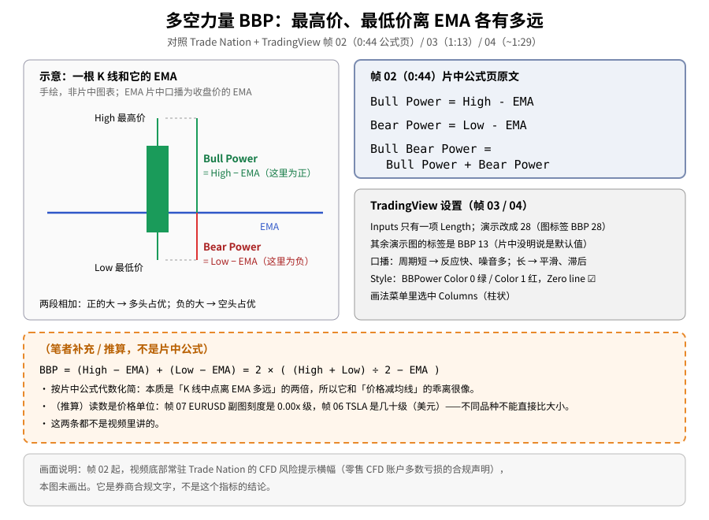
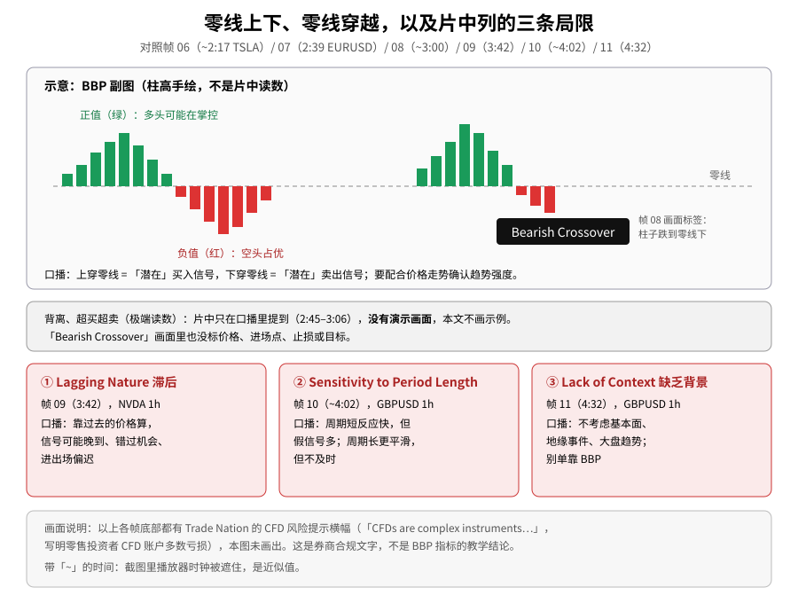
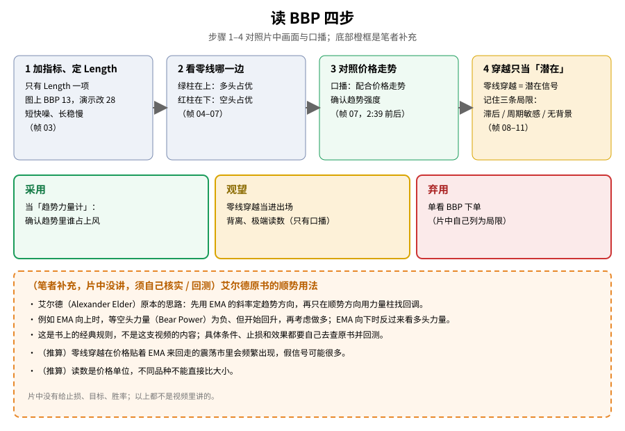

> 学习笔记：Trade Nation + TradingView《Bull Bear Power Indicator on TradingView》（YouTube，5:10，已看完 5:10/5:10）。正文只写片中画面和口播能核对的内容；凡标「（笔者补充）」「（推算）」的都不是片中原话，图里一律画成**橙色虚线框**。这支片**有公式页**（0:44），公式按片中原文写。部分截图的播放器时钟被遮住，那些时间带「~」，是近似值。**画面底部常驻 Trade Nation 的 CFD 风险提示横幅**（见第七节）。**仅供学习，不构成投资建议。**

## 一、它在量什么：多头和空头谁的力气大

帧 01（0:00）是片头「Bull Bear Power indicator on TradingView」。口播：Bull Bear Power **又叫 Elder Ray Index（艾尔德射线）**，衡量买方（多头）和卖方（空头）之间的力量对比。

帧 02（0:44）是**公式页**，原文三行：

```
Bull Power = High - EMA
Bear Power = Low - EMA
Bull Bear Power = Bull Power + Bear Power
```

口播（0:39–0:46）：用这一段时间里的最高价减去**收盘价的指数移动平均（EMA）**，来判断多头或空头的强弱。

人话：
- **多头力量** = 这根 K 线最高冲到哪，比均线高多少——多头最多能把价格推多高。
- **空头力量** = 这根 K 线最低砸到哪，比均线低多少（通常是负数）——空头最多能把价格压多低。
- **BBP** = 两者相加，变成一根围绕零线的柱子。



**读图**
- 左上手绘一根 K 线和 EMA，标出 High − EMA（多头力量）和 Low − EMA（空头力量），不是片中图表。
- 右上蓝框是帧 02 公式页的原文（片中公式）。
- 右中灰框是帧 03 / 04 能核对的设置。
- 底部**橙色虚线框**是（笔者补充 / 推算）的代数化简和「价格单位」说明，**不是片中公式**。
- 最下方灰框说明：帧 02 起视频底部有 CFD 风险横幅，本图没画出。

## 二、参数：只有 Length

- 帧 03（1:13）：BBP 设置 **Inputs** 只有一项 **Length**，演示改成 **28**，图上标签随之变成 **BBP 28**。口播（1:07–1:14）：调周期是一种取舍——**短周期反应快但噪音多，长周期更平滑但可能滞后**。
- 之后各张演示图上的标签都是 **BBP 13**。注意：片中**没有明说「默认值 = 13」**，13 只是图上看到的标签。

## 三、样式：绿红柱、零线

帧 04（~1:29）切到 **Style**：BBPower 勾选，**Color 0 绿 / Color 1 红**，**Zero line** 勾选，Price line 关；画法下拉菜单里选中的是 **Columns**（柱状）。口播（1:23–1:32）：可以改颜色、粗细、样式，让它和图上其他东西区分开。

## 四、怎么看：零线上面多头占优，下面空头占优

片中依次换了几个 1h 图做示例（只描述画面，不写价格）：

- 帧 05（~1:57）：**USDCAD 1h · FXCM**，价格涨到顶再回落，副图柱子由绿转红。口播（1:46–2:01）：它用多空力量对比给出一个简明的市场情绪读数。
- 帧 06（~2:17）：**TSLA 1h · NASDAQ**，急跌时副图一大片深红柱，之后反弹转为绿柱。口播（2:11–2:18）：**正值**表示多头有力，买方可能在掌控，上涨可能延续。
- 帧 07（2:39）：**EURUSD 1h · ICE**，右侧价格向上，副图以绿柱为主。口播（2:18–2:36）：**负值**意味着空头占优、可能走弱或下跌；把 BBP 和**价格走势一起看**，可以帮助确认趋势强度。

## 五、信号：零线穿越只是「潜在」

- 帧 08（~3:00）：EURUSD 图上出现黑底标签 **「Bearish Crossover」**（看跌穿越），对应副图柱子跌到零线下方。画面里**没有**标价格、进场点、止损或目标。
- 口播（2:45–3:06）：信号可以来自**穿越、背离、超买超卖**。柱子**上穿零线 = 潜在买入**，**下穿零线 = 潜在卖出**；随后提到背离可能是反转预警。
- **背离和超买超卖（极端读数）只在口播里提到，片中没有演示画面**，本文不画示例、不举例子。



**读图**
- 上框是手绘的 BBP 副图示意：绿柱在零线上、红柱在零线下，柱高不是片中读数；「Bearish Crossover」标签对照帧 08。
- 中间灰框写明：背离、超买超卖只有口播、没有画面，本文不画。
- 下面三张红卡是片中列的三条局限，各对应帧 09 / 10 / 11。
- 最下方灰框：这些帧底部都有 CFD 风险横幅；带「~」的时间是近似值。

## 六、片中自己列的三条局限

| 局限 | 画面 | 口播大意 |
|---|---|---|
| **Lagging Nature**（滞后） | 帧 09（3:42），NVDA 1h · NASDAQ | 靠过去的价格算，信号可能晚到、错过机会、进出场偏迟（3:32–3:48） |
| **Sensitivity to Period Length**（对周期敏感） | 帧 10（~4:02），GBPUSD 1h · ICE | 周期短反应快但假信号多，周期长更平滑但不及时（3:57–4:14） |
| **Lack of Context**（缺乏背景） | 帧 11（4:32），GBPUSD 1h | 不考虑基本面、地缘事件、大盘趋势；要配合其他信息，别单靠 BBP（4:20–4:59） |

帧 12（5:03）章节名「Limitations of the Bull Bear Power indicator」，随后片尾（帧 13，5:10）。片中**没有**给任何止损、目标、胜率。

可对照旧文：[MACD 组成与交叉（10/22）](./2026-10-22-macd-components-crossover-100ma.md)、[ADX 趋势强度（10/26）](./2026-10-26-adx-trend-strength.md)、[动量震荡 AO（11/10）](./2026-11-10-awesome-oscillator.md)、[变动率 ROC（11/12）](./2026-11-12-rate-of-change-indicator.md)——它们和 BBP 一样都是「辅助看力量 / 动量」，不是独立的下单系统。

## 七、关于画面底部的 CFD 风险横幅

从帧 02 开始，大多数截图底部都有一条 **Trade Nation 的合规横幅**：「CFDs are complex instruments and come with a high risk of losing money rapidly due to leverage…」，并写明这家券商**多数零售投资者的 CFD 账户在亏钱**（横幅原文给了一个百分比）。

- 这是券商按监管要求放的**风险提示**，不是 BBP 指标的教学内容，本文**不把那个百分比当成交易结论**。
- 本文的配图都是手绘示意，没有直接用这些截图，所以图里没画横幅；概念图和局限图最下方都用灰框说明了它的存在。
- 它提醒的事本身值得记住：CFD 带杠杆，亏得快。

## 八、怎么读（四步）

1. 加 BBP，定 Length：短快噪、长稳慢（帧 03）
2. 看柱子在零线哪一边：绿在上多头占优，红在下空头占优（帧 04–07）
3. 和价格走势对照，确认趋势强度（帧 07）
4. 零线穿越只当「潜在」信号，记住三条局限（帧 08–11）



**读图**
- 上行四步依次对应帧 03 → 04–07 → 07 → 08–11；第 4 步是黄色（观望）。
- 中间三色框 = 采用 / 观望 / 弃用。
- 底部**橙色虚线框**是（笔者补充）：艾尔德原书的顺势用法，**片中没讲**，要自己核实、回测；另有两条（推算）。

## 九、（笔者补充 / 推算）——都不是片中内容

- （笔者补充 / 推算）**代数化简**：BBP = (High − EMA) + (Low − EMA) = **2 × (K 线中点 − EMA)**，其中 K 线中点 = (High + Low) ÷ 2。所以 BBP 本质上就是「这根 K 线的中间价离 EMA 多远」的两倍，和「价格减均线」的乖离很像。这是按片中公式推出来的，**片中没有这样写**。
- （笔者补充）**艾尔德原书的用法**：Alexander Elder 原本的思路是先用 **EMA 的斜率定方向**，再只在顺势方向用力量柱找**回调入场**——例如 EMA 向上时，等空头力量为负但开始回升，再考虑做多。这是书上的经典规则，**片中没讲**；具体条件、止损和效果都要自己查原书核实并回测，不能当成这支视频教的内容。
- （推算）**读数是价格单位**：帧 07 的 EURUSD 副图刻度是 0.00x 级，帧 06 的 TSLA 是几十级（美元）。所以不同品种之间不能直接比 BBP 大小，「多大算极端」也只能和这个品种自己的历史比。
- （推算）BBP 跟着 EMA 算，价格贴着 EMA 来回走的震荡市里，零线穿越会很频繁，假信号可能很多——这也和片中「对周期敏感」那条局限一致。

## 十、采用 / 观望 / 弃用

| 内容 | 结论 | 理由 |
|---|---|---|
| 把 BBP 当「趋势力量计」，确认趋势里谁占上风 | **采用** | 公式页清楚（0:44），正负含义有口播 + 多个示例图 |
| Length 的取舍（短快噪、长稳慢） | **采用**（当常识） | 1:13 与 3:57–4:14 两处口播一致 |
| 零线穿越当进出场 | **观望** | 片中只说「潜在」，没给过滤条件；震荡市可能频繁假信号（推算） |
| 背离、超买超卖 | **观望** | 只有口播，没有演示画面 |
| 艾尔德原书的顺势回调入场 | **观望** | （笔者补充）片中没讲，需自己核实、回测 |
| 单看 BBP 下单 | **弃用** | 片中自己列为局限（缺乏背景、滞后）；没有止损、目标、胜率 |

## 参考来源

- Trade Nation + TradingView：[Bull Bear Power Indicator on TradingView](https://www.youtube.com/watch?v=FdrKzj2oQ1A)，时长 **5:10**（加载时短暂显示 5:11），已看完 **5:10/5:10**（到片尾推荐页），YouTube 未登录；全程 1×，Auto 720p；英文自动字幕 + 看完后打开 Show transcript 核对口播。
- **播放说明**：开头加载卡了约 30 秒，出画时已自动播到约 0:48，随后**倒回 0:00 从头看完**；那段自动播放不计入。之后无卡顿、无广告、无跳过。
- 时间戳来自截图（`screenshots/02-elder-ray/`，13 张）与观看记录：0:00 片头、0:44 公式页、1:13 Length 28、~1:29 Style、~1:57 USDCAD、~2:17 TSLA、2:39 EURUSD、~3:00 Bearish Crossover、3:42 Lagging Nature、~4:02 Sensitivity to Period Length、4:32 Lack of Context、5:03 局限章节、5:10 片尾。带「~」的是播放器时钟被遮住的近似时间。
- **缺口**：
  ① 没有新画面、未截图的时段：**0:07–0:29、1:37–1:57、2:40–3:00、3:11–3:31、4:10–4:25**，本文不描述这些时段画面上发生了什么。
  ② 背离、超买超卖：只有口播，没有画面示例。
  ③ 「Bearish Crossover」画面没标价格或进出场点。
  ④ BBP 13 是图上标签，片中没明说是默认值。
  ⑤ 示例图上的价格、BBP 读数本文都没写；画面底部 CFD 风险横幅是券商合规文字。
- 可链接旧文：[MACD 组成与交叉（10/22）](./2026-10-22-macd-components-crossover-100ma.md)、[ADX（10/26）](./2026-10-26-adx-trend-strength.md)、[AO（11/10）](./2026-11-10-awesome-oscillator.md)、[ROC（11/12）](./2026-11-12-rate-of-change-indicator.md)。

> 学习笔记，仅供学习，不构成投资建议。
