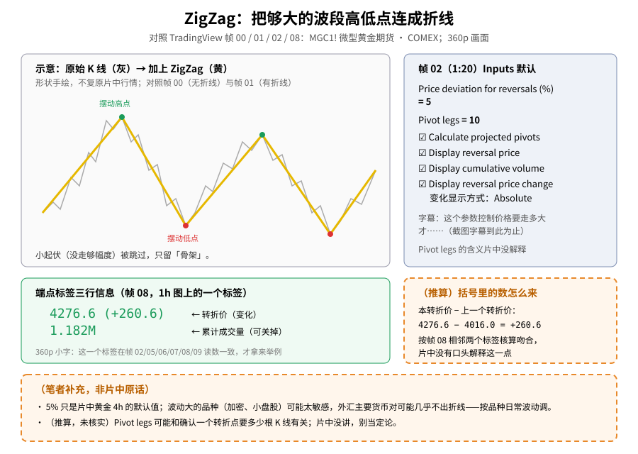
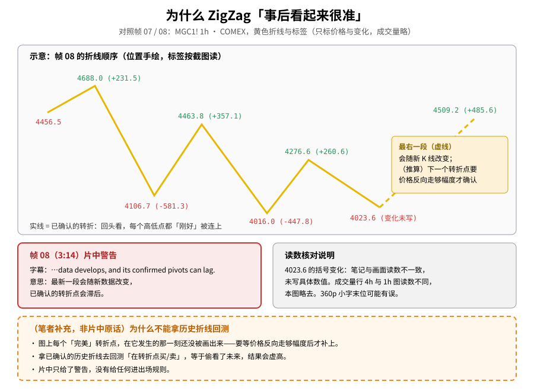
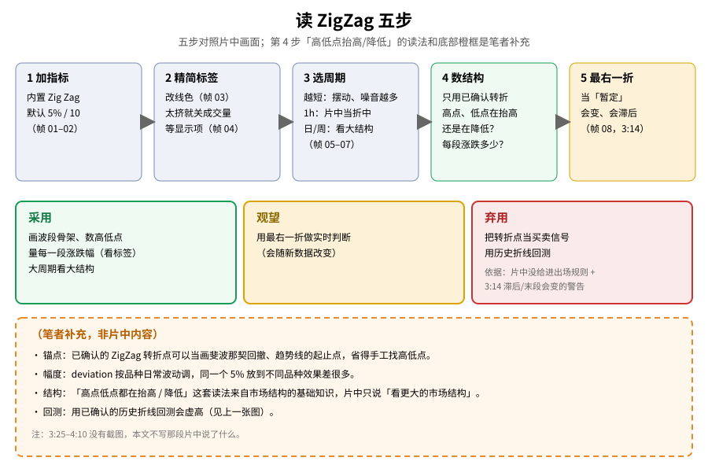

> 学习笔记：TradingView《Zigzag Indicator: Identify Major Market Swings》（YouTube，4:10，已看完 4:10/4:10）。正文只写片中画面能核对的内容；凡标「（笔者补充）」「（推算）」的都不是片中原话，图里一律画成**橙色虚线框**。画质只有 **360p**，标签上的小数字是逐张对照截图读的，读不准或和笔记对不上的一律不写。片中**没有**公式板。**3:25–4:10 没有截图**，那一段本文不转述。**仅供学习，不构成投资建议。**

## 一、它在做什么：把走势画成「骨架」

片中演示品种是 **MGC1!（Micro Gold Futures，微型黄金期货）· COMEX**，先 4h、后切 1h。

- 帧 00（0:00）：只有原始 K 线，字幕「If you want to make price action easier to read」（想让价格走势更容易读懂）。
- 帧 01（0:56）：加上 ZigZag 后，一条蓝色折线把一个个**摆动高点 / 低点**连起来，端点有红 / 绿标签；字幕「these different swing points, giving you this straight line」（这些摆动点，连成直线）。

人话：K 线上下抖个不停，ZigZag 只在价格**反向走够一定幅度**时才算一个转折点，然后用直线把转折点连起来——小起伏被跳过，留下的是波段的「骨架」。

**读图**
- 左上是手绘示意（灰 = 原始走势，黄 = ZigZag），形状不复原片中行情；对照帧 00（无折线）和帧 01（有折线）。
- 右上灰蓝框是帧 02 的 Inputs 默认值，逐项对照截图。
- 中间绿框是一个端点标签的三行信息，用的是在帧 02/05/06/07/08/09 里读数都一致的 `4276.6 (+260.6) 1.182M`。
- 右中、底部两个**橙色虚线框**是（推算）/（笔者补充），不是片中原话。

## 二、参数：默认 5% 和 10

帧 02（1:20）打开 Zig Zag 设置的 **Inputs** 页：

| 项目 | 帧 02 画面 |
|---|---|
| Price deviation for reversals (%) | **5** |
| Pivot legs | **10** |
| Line color | 紫色色块 |
| Calculate projected pivots | ☑ |
| Display reversal price | ☑ |
| Display cumulative volume | ☑ |
| Display reversal price change | ☑，方式 **Absolute** |

字幕在这一刻是「And this controls how large a price move needs to be before」（这个控制价格要走多大才……），截图里的字幕到此为止。

- 帧 03（2:02）：线色改成**黄色**，图上的线跟着变黄；字幕的意思是这些都可以自定义、可以去掉。
- 帧 04（2:12）：**Display cumulative volume 被取消勾选**，字幕「removed when we take that away or added」（去掉或加回）。注意：这张截图里图上的标签**仍然显示着成交量那一行**——去掉之后标签的样子没有截到，本文不描述。
- **Pivot legs 的含义片中没有解释。**（推算，未核实）它可能和「确认一个转折点要多少根 K 线」有关，别当定论。
- 设置对话框在 1:20–2:12 之间一直开着，只截了关键变化，中间的光标操作没有截图，本文不补写。

## 三、标签怎么读：转折价、变化、成交量

每个端点的标签有三行：**转折价**、括号里的**变化**、该段的**累计成交量**（可以关掉）。

帧 07–08（2:56–3:14，1h 图）上，按从左到右的顺序，标签读作：

`4456.5` → `4688.0 (+231.5)` → `4106.7 (-581.3)` → `4463.8 (+357.1)` → `4016.0 (-447.8)` → `4276.6 (+260.6)` → `4023.6`（括号里的变化：**笔记与画面读数不一致，未写具体数值**）→ `4509.2 (+485.6)`

- （推算）括号里的数 = 本转折价 − 上一个转折价，例如 4276.6 − 4016.0 = +260.6；按帧 08 相邻标签核算都吻合。片中没有口头解释这一点。
- 成交量那一行：同一个转折点在 4h 图和 1h 图上的读数不一样（例如 4463.8 那个点），本文**不写**成交量的具体数字。
- 这些是 360p 下读的小字，末位仍可能有误；只当「怎么读标签」的例子，不是行情数据。

## 四、周期：越短越吵，1h 折中，日 / 周看大结构

- 帧 05（2:34，4h）：字幕「although you'll see more swings and noise」（会看到更多摆动和噪音）——观看记录把这段归纳为：周期越短，摆动和噪音越多。
- 帧 06（2:43）：切到 **1h**，字幕的意思是要在 1h 图上看清楚。
- 帧 07（2:56）：拉远看一长串摆动，字幕「for larger market structure」（看更大的市场结构）。

笔记里的总结是：片中把 1h 当折中，日线 / 周线看大结构。

可对照旧文：[BOS 之前先把道氏三步写进 SOP（09/15）](./2026-09-15-BOS之前先把道氏三步写进SOP.md)——那篇讲高点低点怎么定义趋势，ZigZag 正好帮你把这些高低点先标出来。

## 五、片中最重要的一句：最新一段会变，确认会滞后

帧 08（3:14），字幕：**「…data develops, and its confirmed pivots can lag.」** 观看记录里这句完整的口播是：最新的一段会随新的价格数据改变，已确认的转折点会滞后。

**读图**
- 上半部分按帧 08 的顺序画折线，位置手绘，标签按截图读；4023.6 的变化没写（笔记与画面不一致）。
- 实线 = 已确认的转折，回头看每个高低点都「刚好」被连上；最右一段画成虚线 = 会随新 K 线改变。
- 红框是 3:14 的片中警告原句；灰框是读数核对说明。
- 底部**橙色虚线框**（笔者补充）：为什么不能拿历史折线回测。

为什么这点这么关键：

- 一个转折点要等价格**反向走够幅度**之后才会被画出来（推算，由「确认会滞后」推出）。所以你在图上看到的每一个「完美」高点，在它发生的当下其实还没出现。
- 最右边那一折还在变：今天看是一个高点，明天价格继续涨，它就被「抹掉」并延长。
- 所以历史 ZigZag 看起来总是「刚好在最高点卖、最低点买」——那是**事后**画出来的。

（笔者补充）拿已确认的历史折线去回测「在转折点买 / 卖」，等于偷看了未来，结果一定虚高。

## 六、片尾和那段没有截图的 3:25–4:10

- 帧 09（3:25）：拉远的 4h 全景，字幕「simplify price action, identify major swings, and」（简化价格走势、识别主要摆动，以及……）。
- **3:25 之后到 4:10 没有截图**，观看记录也没有逐句记下这段口播。观看笔记里有一句「不要把它当买卖信号、配合其他工具用」，那是**观看者看完后的总结**，没有对应的字幕截图，所以本文**不把它当片中原话**。
- 本文给「当买卖信号」打**弃用**，依据是能核对的两点：① 片中从头到尾**没有给任何进场 / 出场 / 止损规则**；② 3:14 那条「最新一段会变、确认会滞后」的警告。

## 七、怎么读（五步）

1. 加内置 Zig Zag，默认 5% / 10（帧 01–02）
2. 改线色，标签太挤就关掉一些显示项（帧 03–04）
3. 选周期：越短越吵，1h 折中，日 / 周看大结构（帧 05–07）
4. 只用**已确认**的转折点数结构：高点、低点在抬高还是降低？每段涨跌多少？
5. 最右一折只当「暂定」（帧 08）

**读图**
- 上行五步依次对应帧 01–02 → 03–04 → 05–07 → 第 4 步 → 帧 08；第 5 步是黄色（观望）。
- 中间三色框 = 采用 / 观望 / 弃用；弃用框写明了依据（没规则 + 3:14 警告）。
- 底部**橙色虚线框**是（笔者补充）：锚点用法、幅度按品种调、结构读法、回测虚高——都不是片中内容。

## 八、（笔者补充）ZigZag 还能怎么用

- （笔者补充）**幅度按品种调**：5% 是片中黄金上的默认值。放到加密币或小盘股可能太敏感（折线太密），放到外汇主要货币对可能几乎不出折线——要按这个品种平时一段波动有多大来设。
- （笔者补充）**当画线锚点**：已确认的转折点可以直接当 [斐波那契回撤（10/15）](./2026-10-15-fibonacci.md) 或趋势线的起止点，省得手工找高低点。
- （笔者补充）**和其他「高低点」工具对照**：[Pivot Points（11/02）](./2026-11-02-pivot-points.md) 用前一周期高低收算价位，[唐奇安通道（11/10）](./2026-11-10-donchian-channels.md) 用 N 根内最高 / 最低；ZigZag 则是按幅度找波段高低点，三者定义不同，别混用。
- （推算，未核实）Pivot legs 可能和确认转折所需的 K 线数有关，片中没讲。

## 九、采用 / 观望 / 弃用

| 内容 | 结论 | 理由 |
|---|---|---|
| 用 ZigZag 画波段骨架、数高低点 | **采用** | 0:56 起多帧可核对，这就是它的本职 |
| 用标签量每一段涨跌多少 | **采用** | 标签直接给出转折价和变化（帧 05–09）；360p 小字需对照 |
| 参数从默认 5% 起、按品种调；大周期看大结构 | **采用** | 5% / 10 见帧 02；按品种调是（笔者补充） |
| 用最右一折做实时判断 | **观望** | 3:14 片中警告：最新一段会变 |
| 把转折点当买卖信号 | **弃用** | 片中没给任何进出场规则 + 3:14 滞后警告 |
| 用历史折线回测 | **弃用** | 已确认折线是事后画的，结果虚高（笔者补充） |

## 参考来源

- TradingView：[Zigzag Indicator: Identify Major Market Swings](https://www.youtube.com/watch?v=8a5kxygB5jY)，时长 **4:10**，已看完 **4:10/4:10**（片尾出现 Replay），YouTube 未登录；0:00–0:56 为 1×，之后 1.25×；画质 **360p**（试切 720p 未生效）；无广告、无卡顿、无跳过。
- 时间戳来自截图（`screenshots/01-zigzag/`，10 张）与观看记录：0:00 原始图、0:56 折线、1:20 Inputs 默认、2:02 改线色、2:12 取消成交量、2:34 4h 噪音、2:43 切 1h、2:56 大结构、3:14 滞后警告、3:25 总结画面。
- **缺口**：
  ① **3:25–4:10 没有截图**，观看记录也没逐句记口播；「别当买卖信号、配合其他工具」是观看者总结，没有字幕截图，本文不当片中原话。
  ② 1:20–2:12 设置对话框期间只截了关键变化，中间光标操作没截；帧 04 取消成交量后标签变化没截到。
  ③ 360p：标签小数字末位可能有误；4023.6 的括号变化笔记与画面不一致，未写；成交量行 4h / 1h 读数不同，未写具体数。
  ④ 片中没有公式板，也没解释 Pivot legs。
- 可链接旧文：[BOS 与道氏三步（09/15）](./2026-09-15-BOS之前先把道氏三步写进SOP.md)、[斐波那契（10/15）](./2026-10-15-fibonacci.md)、[Pivot Points（11/02）](./2026-11-02-pivot-points.md)、[唐奇安通道（11/10）](./2026-11-10-donchian-channels.md)。

> 学习笔记，仅供学习，不构成投资建议。
